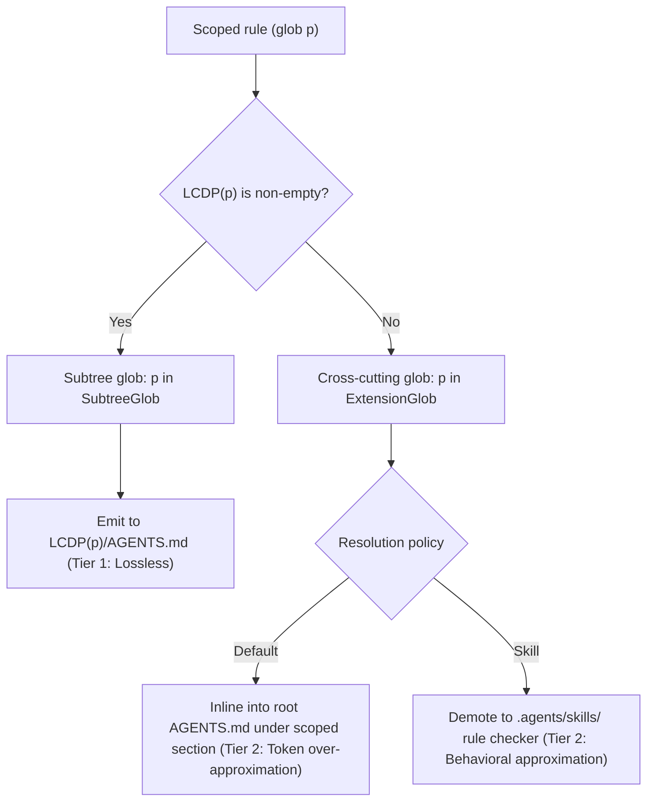
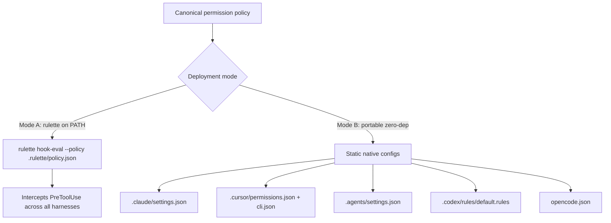
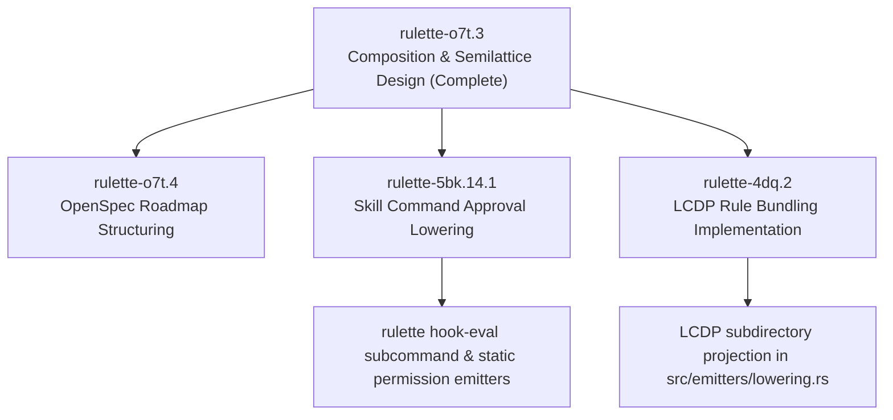

# Algebraic composition, permission semilattice, and hook shim design (`rulette-o7t.3`)

## Executive summary

This document specifies the algebraic composition rules, permission semilattice, Longest Common Directory Prefix (LCDP) rule projections, and zero-dependency hook shim for `rulette`.
It resolves the architecture requirements in Section 3 of [docs/2026-10-24-gemini-argon-external-research.md](file:///home/mkobit/workspace/mkobit/rulette/docs/2026-10-24-gemini-argon-external-research.md).
It incorporates the runtime boundary decision from [docs/2026-10-25-cli-ux-and-bazel-style-build-pipeline.md](file:///home/mkobit/workspace/mkobit/rulette/docs/2026-10-25-cli-ux-and-bazel-style-build-pipeline.md) and addresses the gaps in [docs/2026-10-26-ir-and-pipeline-matrix-audit.md](file:///home/mkobit/workspace/mkobit/rulette/docs/2026-10-26-ir-and-pipeline-matrix-audit.md).
This design unblocks [rulette-o7t.4](file:///home/mkobit/workspace/mkobit/rulette/docs/2026-10-26-ir-and-pipeline-matrix-audit.md), [rulette-5bk.14.1](file:///home/mkobit/workspace/mkobit/rulette/openspec/changes/permission-precedence/proposal.md), and [rulette-4dq.2](file:///home/mkobit/workspace/mkobit/rulette/openspec/changes/rule-bundling-and-marketplace-transforms/proposal.md).

---

## 1. Composition algebra and target taxonomy

Multi-source transposition requires deterministic combination of disparate input configurations.
Combining rule sets, skill definitions, subagents, and permission policies forms an algebraic structure over configuration bundles.

### Algebraic properties of package composition

Let $\mathcal{B}$ denote the set of all configuration bundles.
Binary composition $\sqcup: \mathcal{B} \times \mathcal{B} \to \mathcal{B}$ combines two bundles into a merged bundle.
The composition operator satisfies three algebraic laws:

1. **Associativity**: $(B_1 \sqcup B_2) \sqcup B_3 = B_1 \sqcup (B_2 \sqcup B_3)$.
   Evaluation order across three or more sources does not change the result.
2. **Commutativity**: $B_1 \sqcup B_2 = B_2 \sqcup B_1$.
   Discovery order and file walk sequence do not change the result.
3. **Idempotence**: $B \sqcup B = B$.
   Duplicate sources or redundant imports do not duplicate emitted rules or change decisions.

These properties guarantee that compilation results depend only on content digests, matching the content-addressed contract of `rulette`.

### Target evaluation taxonomy

Target harnesses evaluate rules and permissions through two incompatible evaluation models:

| Evaluation model | Target harnesses | Native evaluation semantics | Composition requirements |
| :--- | :--- | :--- | :--- |
| **Commutative lattice** | Claude Code, Cursor, Google Antigravity, OpenAI Codex | Evaluates permission action categories with fixed dominance (`Deny` overrides `Ask`, `Ask` overrides `Allow`). Order of rules in native files does not change evaluation. | Target emitter sorts rules deterministically by pattern and specificity. Action categories map directly to native set arrays or rule collections. |
| **Non-commutative right-zero semigroup** | OpenCode | Evaluates key-value maps sequentially in document order where the last matching key determines the decision ($d_1 \triangleright d_2 = d_2$). | Target emitter must topologically sort keys by ascending precedence tier (`Tier 1` to `Tier 4`). Denials must emit last so they override prior grants. |

---

## 2. Permission join-semilattice

Security governance requires a fail-closed precedence model when multiple sources specify access rules.

### Lattice structure and order relations

Let $\mathcal{D} = \{\text{Allow}, \text{Ask}, \text{Deny}\}$ denote the set of permission decisions.
We define a strict partial order $\prec$ by restrictiveness:

$$\text{Allow} \prec \text{Ask} \prec \text{Deny}$$

The pair $(\mathcal{D}, \sqcup)$ forms a bounded join-semilattice:

- Bottom element: $\bot = \text{Allow}$.
- Top element: $\top = \text{Deny}$.
- Binary join: $d_1 \sqcup d_2 = \max_{\prec}(d_1, d_2)$.

For any two decisions $d_1, d_2 \in \mathcal{D}$:

- If either decision is $\text{Deny}$, the joined decision is $\text{Deny}$.
- If neither decision is $\text{Deny}$ and either decision is $\text{Ask}$, the joined decision is $\text{Ask}$.
- Only if both decisions are $\text{Allow}$, the joined decision is $\text{Allow}$.

### Authority scope hierarchy

Configuration sources operate at different authority tiers.
Let $\mathcal{S} = \{\text{User}, \text{Project}, \text{Local}, \text{Enterprise}\}$ denote configuration scopes with authority ranks:

$$\text{rank}(\text{User}) = 1 < \text{rank}(\text{Project}) = 2 < \text{rank}(\text{Local}) = 3 < \text{rank}(\text{Enterprise}) = 4$$

When combining two rules with the same normalized pattern from scopes $s_1$ and $s_2$:

- If either rule specifies `Deny`, the resolved decision is `Deny` regardless of scope.
  A user or project configuration cannot weaken an enterprise restriction.
- For non-`Deny` rules, the rule from the higher authority scope wins:
  $$\text{resolve}(r_1, r_2) = \begin{cases} r_1 & \text{if } \text{rank}(s_1) > \text{rank}(s_2) \\ r_2 & \text{if } \text{rank}(s_2) > \text{rank}(s_1) \\ r_1 \sqcup r_2 & \text{if } \text{rank}(s_1) = \text{rank}(s_2) \end{cases}$$

Scope authority ranking applies during deduplication of identical `(CanonicalTool, NormalizedPattern)` pairs.
When rules specify distinct or overlapping patterns across scopes (such as Enterprise `npm *` Allow and Project `npm test` Ask), both rules enter the four-tier precedence hierarchy.
Fail-closed tier ordering and pattern specificity take precedence over authority scope rank when patterns differ.
In this scenario, `npm test` in Tier 3 takes precedence over `npm *` in Tier 2, ensuring that narrower project prompts or restrictions are not silenced by broad defaults.

### Four-tier total precedence ordering

To unify commutative lattice targets and sequential targets, `rulette` assigns every rule to one of four canonical tiers:

```text
Tier 1a: UniversalAllow (lowest precedence)
  Rules where pattern == "*" and action == Allow.
  Order: universal tool ("*") before exact tools, then tie-break key.

Tier 1b: UniversalAsk
  Rules where pattern == "*" and action == Ask.
  Order: universal tool ("*") before exact tools, then tie-break key.

Tier 2: SpecificAllow
  Rules where pattern != "*" and action == Allow.
  Order: ascending SpecificityKey, canonical tool, pattern, tie-break key.

Tier 3: SpecificAsk
  Rules where pattern != "*" and action == Ask.
  Order: ascending SpecificityKey, canonical tool, pattern, tie-break key.

Tier 4: HardDeny (highest precedence)
  All rules where action == Deny (both universal and specific patterns).
  Order: ascending SpecificityKey, canonical tool, pattern, tie-break key.
```

### Equivalence proof for OpenCode

OpenCode evaluates permission maps sequentially and takes the last matching entry.
Let $M$ be a set of rules matching a candidate tool invocation.
The set-based lattice decision is $\max_{r \in M} \text{tier}(r)$.

When `rulette` emits OpenCode keys in ascending tier order (`Tier 1a` $\to$ `Tier 1b` $\to$ `Tier 2` $\to$ `Tier 3` $\to$ `Tier 4`):

1. Any matching `Tier 4` rule appears after all matching `Tier 3`, `Tier 2`, `Tier 1b`, and `Tier 1a` rules.
2. Any matching `Tier 3` rule appears after all matching `Tier 2`, `Tier 1b`, and `Tier 1a` rules.
3. Any matching `Tier 1b` (`UniversalAsk`) appears after `Tier 1a` (`UniversalAllow`).
4. The last matching entry in the map belongs to the highest matching tier.
5. Therefore, OpenCode sequential evaluation produces the exact same decision as the set-based lattice.

### Pattern specificity and shadowing detection

Each pattern produces a 6-tuple `SpecificityKey` compared lexicographically:

1. `tool_is_exact`: boolean (`true` for named tools like `bash`, `false` for `*`).
2. `class`: enum (`UniversalWildcard` = 1, `UnanchoredGlob` = 2, `AnchoredPrefix` = 3, `Exact` = 4).
3. `leading_literal_len`: byte count of literal text preceding the first wildcard.
4. `literal_segment_count`: count of non-empty slash or whitespace segments with literal text.
5. `total_literal_len`: total non-wildcard byte count.
6. `negated_wildcard_count`: fewer wildcards wins when literal counts match.

When a higher-tier rule $R_{\text{high}}$ ($\text{Tier } 3$ or $\text{Tier } 4$) structurally covers all inputs of a lower-tier rule $R_{\text{low}}$:

1. $R_{\text{high}}$ subsumes $R_{\text{low}}$ ($R_{\text{high}}.\text{subsumes}(R_{\text{low}}) = \text{true}$).
2. $R_{\text{low}}$ cannot change the evaluation decision on any input.
3. `rulette` prunes $R_{\text{low}}$ from the active rule list.
4. In strict mode, `rulette` reports a loss finding with `permission-precedence-unrepresentable`.
5. Under `--allow-lossy`, `rulette` compiles the fail-closed effective policy without $R_{\text{low}}$.

---

## 3. Longest common directory prefix (LCDP) rule projection

Harnesses differ in how they apply scoped rules to subtrees.

### Cross-harness rule scoping gap

- Claude Code evaluates `.claude/rules/<id>.md` files with `paths: [...]` globs.
- Cursor evaluates `.cursor/rules/<id>.mdc` files with `globs: [...]` and `alwaysApply: false`.
- Google Antigravity evaluates `.agents/rules/<id>.md` files with `trigger: glob` and `globs: [...]`.
- OpenAI Codex does not support glob-scoped rule files.
  Codex only reads `AGENTS.md` in `$CWD` and parent directories up to the repository root.

Naive rule bundling merges all rules into the root `AGENTS.md`.
This naive bundling inflates token counts for unrelated tasks and loses file-scoped isolation.

### Mathematical definition of LCDP

Let $p$ be a path glob string consisting of segments separated by `/`.
The Longest Common Directory Prefix $\text{LCDP}(p)$ is the longest directory path prefix containing zero wildcard characters (`*`, `?`, `[`):

$$\text{LCDP}(p) = \text{parent\_dir}(\text{literal\_prefix}(p))$$

Examples:

- $\text{LCDP}(\text{"src/api/**/*.ts"}) = \text{"src/api"}$.
- $\text{LCDP}(\text{"crates/core/src/parser.rs"}) = \text{"crates/core/src"}$.
- $\text{LCDP}(\text{"frontend/components/*.tsx"}) = \text{"frontend/components"}$.
- $\text{LCDP}(\text{"**/*.test.ts"}) = \text{""}$ (root directory).

### Projection strategy for OpenAI Codex

`rulette` partitions scoped rules into two classes:



1. **Subtree globs ($\text{LCDP}(p) \neq \text{""}$)**:
   - `rulette` projects the rule body into `<LCDP(p)>/AGENTS.md`.
   - Codex loads `<LCDP(p)>/AGENTS.md` automatically when the model navigates into that directory.
   - Classification: **Tier 1 (Lossless AST Lowering)**.
2. **Cross-cutting extension globs ($\text{LCDP}(p) = \text{""}$)**:
   - For globs such as `**/*.test.ts` or `*.md`, the common prefix is the repository root.
   - Option A (default): inline the rule into root `AGENTS.md` under a markdown section header with an explicit scope annotation:

     ```markdown
     <!-- rulette:scoped-rule id="test-conventions" paths=["**/*.test.ts"] -->
     ## Test conventions (applies to **/*.test.ts)
     ```

     Classification: **Tier 2 (Token Over-Approximation)**.
   - Option B: convert the rule into an auto-invocable skill in `.agents/skills/<id>/SKILL.md`.
     Classification: **Tier 2 (Behavioral Approximation)**.
   - `rulette plan` and `rulette sync` report a `Tier 2` diagnostic warning identifying the over-approximated rule.

### Multi-rule collision resolution within directories

When multiple rules project to the same `<dir>/AGENTS.md` file:

1. `rulette` sorts rules deterministically by `(SemanticIdentity, PackageId)`.
2. Each rule renders with a clear markdown separator and provenance header.
3. If an existing hand-written `<dir>/AGENTS.md` exists, `rulette` preserves existing user content above managed markers.

---

## 4. Polyglot PreToolUse hook shim architecture

Zero-mutation command governance requires intercepting shell tool invocations before execution.

### Tension resolution: dropping `rulette-guard.py`

Section 3.C in [docs/2026-10-24-gemini-argon-external-research.md](file:///home/mkobit/workspace/mkobit/rulette/docs/2026-10-24-gemini-argon-external-research.md) proposed synthesizing an external Python script `rulette-guard.py`.
Decision 2 in [docs/2026-10-25-cli-ux-and-bazel-style-build-pipeline.md](file:///home/mkobit/workspace/mkobit/rulette/docs/2026-10-25-cli-ux-and-bazel-style-build-pipeline.md) rejected script synthesis.
Generating Python or shell scripts violates the hard constraint of a single static binary with zero runtime dependencies.
Python is not available in minimal containers, Windows environments without Python, or restricted sandboxes.

### Two-mode architecture

`rulette` implements two zero-dependency runtime modes:



#### Mode A: self-invoking static binary hook (`rulette hook-eval`)

When `rulette` is installed on the developer machine, `rulette` configures harnesses to invoke `rulette hook-eval`:

```json
{
  "command": "rulette hook-eval --policy .rulette/policy.json"
}
```

Execution properties:

1. **Zero external dependencies**: runs directly from the static binary without Python, Node, or Bash.
2. **Sub-millisecond startup**: execution completes in under 1 millisecond.
3. **Hermetic evaluation**: reads incoming JSON from standard input, evaluates the compiled semilattice, and prints target-native JSON to standard output.
4. **Platform executable normalization**: on Windows hosts, emitters normalize the invocation command to `rulette.exe hook-eval`.

#### Mode B: static configuration emission (`permission_mode = "static"`)

When distributing bundles to teammates who lack the `rulette` binary:

1. `rulette` compiles the semilattice into native static configuration files.
2. Target files:
   - Claude Code: `.claude/settings.json` (`permissions.allow`, `ask`, `deny`).
   - Cursor: `.cursor/permissions.json` (allowlists) and `.cursor/cli.json` (`allow`, `deny`).
   - Google Antigravity: `.agents/settings.json` (grant arrays).
   - OpenAI Codex: `.codex/rules/default.rules` (Starlark `prefix_rule`).
   - OpenCode: `opencode.json` (topologically sorted `permission.shell` map).
3. Tool scope boundary: `opencode.json` only accepts shell command patterns under `permission.shell`.
   Non-shell tool permissions map to OpenCode agent frontmatter blocks (`.opencode/agents/*.md`) or emit Tier 3 diagnostic findings (`permission-tool-unrepresentable`).

### Native hook wiring across harnesses

Each harness invokes `rulette hook-eval` through its native hook manifest:

| Harness | Manifest path | Event | Matcher | Native approval response |
| :--- | :--- | :--- | :--- | :--- |
| **Google Antigravity** | `.agents/hooks.json` or `hooks.json` | `PreToolUse` | `"run_command"` | `{"decision": "auto_approve", "reason": "rulette policy", "permissionOverrides": ["command(...)"]}` |
| **Cursor** | `.cursor/hooks.json` or `hooks/hooks.json` | `beforeShellExecution` or `preToolUse` | `"Shell"` | `{"permission": "allow"}` (exit code `0`; exit `2` for deny) |
| **Claude Code** | `.claude/settings.json` or `hooks/hooks.json` | `PreToolUse` | `"Bash"` | `{"hookSpecificOutput": {"hookEventName": "PreToolUse", "permissionDecision": "allow"}}` |
| **OpenAI Codex** | `.codex/hooks.json` or `hooks/hooks.json` | `PreToolUse` | `"^Bash$"` | `{"hookSpecificOutput": {"hookEventName": "PreToolUse", "permissionDecision": "allow"}}` |

### Command line normalization and compound parsing

`rulette hook-eval` processes raw tool arguments across harnesses:

1. **Input payload extraction**:
   - Antigravity: `toolCall.args.CommandLine` (string).
   - Cursor: `command` (string).
   - Claude Code: `tool_input.command` (string).
   - Codex: `tool_input.command` (string).
2. **Compound shell parsing**:
   - Shell commands frequently chain subcommands using `&&`, `||`, `;`, and `|`.
   - `rulette hook-eval` tokenizes the command line and splits on operators outside quotes.
   - Example: `git status && npm test` splits into `["git status", "npm test"]`.
3. **Fail-closed compound evaluation**:
   - Each individual subcommand is evaluated against the compiled permission semilattice.
   - Let $D = \{d_1, d_2, \dots, d_k\}$ be the decisions for each subcommand.
   - The effective compound decision is:
     $$d_{\text{effective}} = \bigsqcup_{i=1}^k d_i$$
   - If *any* subcommand is `Deny`, the entire command is rejected (`Deny`).
   - If *any* subcommand requires `Ask` and none are `Deny`, the harness prompts the user (`Ask`).
   - Only if *all* subcommands evaluate to `Allow`, the command is auto-approved (`Allow`).

---

## 5. Skill command approval lowering and scope widening

Claude Code supports `allowed-tools: Bash(...)` within skill definitions (`SKILL.md`).

### The scope widening hazard

In Claude Code, `allowed-tools: Bash(npm test *)` in `SKILL.md` grants auto-approval *only while that specific skill is actively executing in the turn*.
Other harnesses (Cursor, Antigravity, Codex, OpenCode) do not support skill-scoped dynamic permission narrowing.
Lowering `allowed-tools` to `.cursor/cli.json`, `.agents/settings.json`, or a global `PreToolUse` hook approves `npm test` *across the entire user session*.

### Governance policy

1. **Default mode (`max_lossiness_tier = 2`)**:
   - `rulette` lowers skill-scoped commands to the session-wide static configuration or hook policy.
   - `rulette plan` and `rulette sync` record a **Tier 2 (Scope Widening: Skill $\to$ Session)** loss finding.
   - The finding states the exact skill identifier and widened command prefix.
2. **Strict mode (`max_lossiness_tier = 1` or `--strict`)**:
   - `rulette` rejects scope widening with a non-zero exit code.
   - The developer must either explicitly promote the permission rule to the top-level `permissions` block or pass `--allow-lossy`.

---

## 6. Four-tier diagnostic output model

`rulette plan`, `rulette check`, and `rulette sync` output deterministic fidelity classifications:

| Fidelity tier | Classification | Transformation examples | Diagnostic behavior |
| :--- | :--- | :--- | :--- |
| **Tier 0** | Zero-copy | Identical `SKILL.md` body copying, `AGENTS.md` text pass-through, script assets. | Recorded as `Supported` without warnings. |
| **Tier 1** | Lossless AST lowering | Scoped `.mdc` $\leftrightarrow$ `.claude/rules/` $\leftrightarrow$ `.agents/rules/`; LCDP subtree projection to `<subdir>/AGENTS.md`; permission semilattice to Starlark `prefix_rule` or Antigravity grants. | Recorded as `Supported` with target format conversion note. |
| **Tier 2** | Behavioral approximation | Scope widening (skill `allowed-tools` to session permission); LCDP extension glob inlined into root `AGENTS.md`; Cursor `cli.json` promoting `Ask` carve-outs to `Deny`. | Emits `Lossy` diagnostic finding; allowed by default; rejected under `--strict`. |
| **Tier 3** | Dropped / unrepresentable | Unrepresentable tool permissions without hook support; unsupported host-specific hooks (`register.js`); interactive prompt directives. | Emits `Dropped` finding; rejected unless `--allow-lossy` is passed. |

---

## 7. Downstream implementation blueprint

This design prepares implementation across three downstream Beads tasks:



### Module ownership and dependencies

1. **`rulette-o7t.4` (Roadmap structuring)**:
   - Creates OpenSpec change proposals aligning `ir-core`, `transform-pipeline`, and `frontends-and-backends` with this design.
2. **`rulette-5bk.14.1` (Skill command approval & permissions)**:
   - Implements `src/ir/permissions.rs` with `PermissionAction`, `PermissionScope`, and the join-semilattice.
   - Adds the `rulette hook-eval` subcommand to `src/cli/commands/hook_eval.rs`.
   - Emits native permission configurations and hook manifests.
3. **`rulette-4dq.2` (Rule bundling & LCDP)**:
   - Implements `calculate_lcdp(pattern: &str) -> PathBuf` in `src/emitters/lowering.rs`.
   - Replaces single-file instruction collisions with LCDP `<subdir>/AGENTS.md` projections and root bundling.
