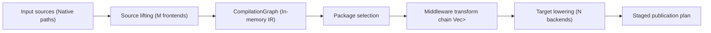

# API reshaping evaluation: canonical declarative rulette.yaml schema vs pipeline transform verbs (`rulette-o7t.2`)

## Executive summary

This document evaluates the API reshaping tension between a proprietary canonical declarative authoring schema (`rulette.yaml`) and the format-agnostic transposition pipeline command model.
It analyzes Section 4 of [docs/2026-10-24-gemini-argon-external-research.md](file:///home/mkobit/workspace/mkobit/rulette/docs/2026-10-24-gemini-argon-external-research.md).
It confirms Decision 1 and Decision 4 in [docs/2026-10-25-cli-ux-and-bazel-style-build-pipeline.md](file:///home/mkobit/workspace/mkobit/rulette/docs/2026-10-25-cli-ux-and-bazel-style-build-pipeline.md).
This evaluation unblocks [rulette-4dq.4](file:///home/mkobit/workspace/mkobit/rulette/openspec/changes/rule-bundling-and-marketplace-transforms/tasks.md) and [rulette-o7t.4](file:///home/mkobit/workspace/mkobit/rulette/docs/2026-10-26-ir-and-pipeline-matrix-audit.md).

The evaluation confirms three primary architectural decisions:

1. **Native-to-native ($M \to N$) transposition is the primary contract**:
   `rulette` ingests native configurations directly from repository paths.
   `rulette` does not force users to author rules, skills, agents, or permissions in a proprietary schema.
2. **`rulette.yaml` and `rulette.toml` act as optional pipeline manifests**:
   The configuration file declares input sources, pipeline transform steps, and target outputs.
   The file functions like a Bazel `BUILD` file or `.bazelrc`, not a replacement authoring format.
3. **In-memory middleware transform chain on compilation graph**:
   Transformations execute through the [`Transform`](file:///home/mkobit/workspace/mkobit/rulette/src/pipeline/mod.rs) trait in memory.
   The pipeline operates on [`CompilationGraph`](file:///home/mkobit/workspace/mkobit/rulette/src/ir/graph.rs) between ingestion and target backend lowering.

---

## 1. Architectural tension and context

Section 4 in [docs/2026-10-24-gemini-argon-external-research.md](file:///home/mkobit/workspace/mkobit/rulette/docs/2026-10-24-gemini-argon-external-research.md) proposed a unified declarative schema:

```yaml
# Proposed rulette.yaml authoring schema
name: my-team-kit
version: 1.0.0
description: Shared rules, skills, subagents, and command policies.

rules:
  - id: global-style
    trigger: always_on
    body_file: ./rules/global.md
skills:
  - id: pr-check
    allowed_commands: [["npm", "test"]]
agents:
  - id: security-auditor
    readonly: true
permissions:
  commands:
    allow:
      - prefix: ["git", "status"]
```

This proposal creates an architectural conflict with existing designs:

1. [openspec/specs/transform-pipeline/spec.md](file:///home/mkobit/workspace/mkobit/rulette/openspec/specs/transform-pipeline/spec.md) defines a command-driven pipeline model.
2. [openspec/changes/transform-config/](file:///home/mkobit/workspace/mkobit/rulette/openspec/changes/transform-config/) defines a declarative pipeline configuration file for inputs, transforms, and outputs.
3. [rulette-4dq.4](file:///home/mkobit/workspace/mkobit/rulette/openspec/changes/rule-bundling-and-marketplace-transforms/tasks.md) risks supersession if `rulette.yaml` replaces the pipeline configuration.

---

## 2. Landscape and ecosystem comparison

We evaluated adjacent tools and standards to determine market positioning.

### Comparison matrix

| Capability | Proprietary manifest (e.g. RuleSync `rulesync.json`) | Canonical authoring (`rulette.yaml` only) | Transposition compiler (`rulette` design) |
| :--- | :--- | :--- | :--- |
| **Input format** | Proprietary JSON manifest | Proprietary YAML schema | Native directories (`.claude/`, `.cursor/`, `.agents/`, `.codex/`) |
| **Ecosystem compatibility** | Breaks native IDE extensions | Breaks native IDE extensions | Preserves native IDE tooling |
| **Open standards** | Ignores Agent Skills standard | Wraps Agent Skills standard | Direct ingestion of Agent Skills and Agent Plugins 1.0 |
| **Adoption barrier** | High (full authoring rewrite) | High (full authoring rewrite) | Low (transposes existing repository files) |
| **Third-party tool integration** | Fails with external package managers | Requires import converters | Composes with `npx skills add` and Git submodules |
| **Pipeline transforms** | None (static copying only) | None (static emission only) | In-memory middleware (`Filter`, `Rename`, `Redact`, `Clamp`) |

### Detailed landscape findings

1. **RuleSync positioning**:
   RuleSync forces developers into a centralized `rulesync.json` configuration file.
   Developers report friction because IDEs cannot validate or auto-complete proprietary rule wrappers.
   Rulette must not duplicate this authoring lock-in.
2. **Open standards convergence**:
   The [Agent Skills specification](https://agentskills.io/specification) establishes `.agents/skills/<id>/SKILL.md` as an industry standard.
   Cursor, Google Antigravity, and OpenAI Codex read this directory natively.
   The [Agent Plugins 1.0.0 specification](https://agent-plugins.org/specification) defines cross-harness plugin layouts.
   Rulette positions as a compiler between native formats and standards, not a competing authoring standard.

---

## 3. Trade-off analysis: authoring schema vs pipeline verbs

We evaluated two competing operational models:

### Model A: Canonical authoring manifest (`rulette.yaml` as single authoring source)

- **Description**: Developers write all instructions, frontmatter, subagent profiles, and permissions in `rulette.yaml`.
- **Advantages**:
  - Provides a single file to view team configuration.
  - Simplifies single-project greenfield setup.
- **Disadvantages**:
  - Requires developers to rewrite existing native configurations.
  - Breaks native syntax highlighting and schema validation in VS Code, Cursor, and Android Studio.
  - Blocks external tools that write directly to `.agents/skills/`.
  - Creates maintenance drag when upstream harness frontmatter adds new fields.

### Model B: Transposition pipeline ($M \to N$ compiler with workspace configuration)

- **Description**: Developers author configurations in native formats or standards. `rulette` reads existing files, executes in-memory transforms, and lowers target files. `rulette.toml` or `rulette.yaml` configures sources, transforms, and target defaults.
- **Advantages**:
  - Zero migration cost for existing repositories.
  - Compatible with native IDE features and extension linters.
  - Composes with external package managers (`npx skills add <pkg>`).
  - Enables powerful automated supply-chain hygiene (sanitization, redaction, security clamping).
- **Disadvantages**:
  - Compiler requires frontends for multiple input formats.
  - Cross-domain lowering requires explicit fidelity loss tracking.

### Decision outcome

Rulette adopts **Model B**.
Native-to-native transposition is the foundation of `rulette`.
`rulette.yaml` and `rulette.toml` serve as optional pipeline and workspace manifests.

---

## 4. In-memory middleware transform architecture

Rather than embedding rules in YAML, `rulette` reshapes its pipeline API into functional in-memory middleware.

### Pipeline execution flow



### The `Transform` trait

The pipeline defines the [`Transform`](file:///home/mkobit/workspace/mkobit/rulette/src/pipeline/mod.rs) trait in `src/pipeline/mod.rs`:

```rust
pub trait Transform: Send + Sync {
    fn name(&self) -> &'static str;
    fn apply(&self, graph: &mut CompilationGraph) -> Result<()>;
}
```

The pipeline provides sequential evaluation with graph validation:

```rust
pub fn apply_transforms(
    graph: &mut CompilationGraph,
    transforms: &[Box<dyn Transform>],
) -> Result<()> {
    graph.validate()?;
    for transform in transforms {
        transform.apply(graph)?;
        graph.validate()?;
    }
    Ok(())
}
```

### Standard middleware transformations

Downstream tasks will implement standard middleware transforms:

1. **`FilterTransform`**: Retains or excludes packages based on semantic identity or metadata.
2. **`RenameAndRewriteRefsTransform`**: Renames skills or rules and rewrites cross-references in instructions.
3. **`RedactRegexTransform`**: Redacts internal secrets, internal URLs, or tokens before emission.
4. **`ClampPermissionsTransform`**: Clamps permission grants to restrict execution to approved commands.
5. **`MapModelsTransform`**: Rewrites subagent model names to match organization-approved model tiers.

---

## 5. Unified workspace configuration schema

The workspace configuration file (`rulette.toml` or `rulette.yaml`) unifies pipeline flags into a reproducible manifest:

```toml
# rulette.toml — Workspace Pipeline Manifest
version = "1"

[workspace]
name = "enterprise-rules"

[[sources]]
path = ".agents/skills"
frontend = "skills"

[[sources]]
path = ".cursor/rules"
frontend = "cursor"

[[pipeline]]
step = "filter"
exclude = ["rule:draft-*"]

[[pipeline]]
step = "clamp_permissions"
max_action = "ask"

[[targets]]
target = "claude"
scope = "project"

[[targets]]
target = "codex"
scope = "project"
allow_lossy = false
```

The schema extends the existing [`TransformConfigFile`](file:///home/mkobit/workspace/mkobit/rulette/src/cli/commands/transform.rs#L120).
It maintains backward compatibility with existing command invocations.

---

## 6. CLI verb lifecycle

The CLI command model aligns with compiler best practices:

1. **`rulette transform`**:
   Retained for backward compatibility and ad-hoc single-command invocations.
2. **`rulette sync`**:
   The primary build command.
   Reads sources, runs pipeline transforms, and writes outputs to targets.
3. **`rulette plan`**:
   Dry-run mode.
   Computes AST diffs and generates the fidelity loss report without writing to disk.
4. **`rulette check`**:
   CI gate command.
   Validates schema compliance, runs security checks, and enforces strict lossiness budgets.
5. **`rulette revert`**:
   Clean command.
   Uses `.rulette/ledger.json` to revert generated files and restore modified configurations.

---

## 7. Resolution of downstream tasks

This evaluation resolves pending questions for downstream Beads tasks:

1. **`rulette-4dq.4` is not superseded**:
   [rulette-4dq.4](file:///home/mkobit/workspace/mkobit/rulette/openspec/changes/rule-bundling-and-marketplace-transforms/tasks.md) adds `rule_bundling` and `marketplace_plugins` to `TransformConfigFile`.
   This capability directly enriches the workspace pipeline manifest.
   Task `rulette-4dq.4` can proceed without redesign.
2. **`rulette-o7t.4` is unblocked**:
   The OpenSpec roadmap structuring task can structure proposals around the pipeline compiler architecture.
   Proposals will target in-memory IR transforms, LCDP projection, permission semilattices, and polyglot hook shims.
