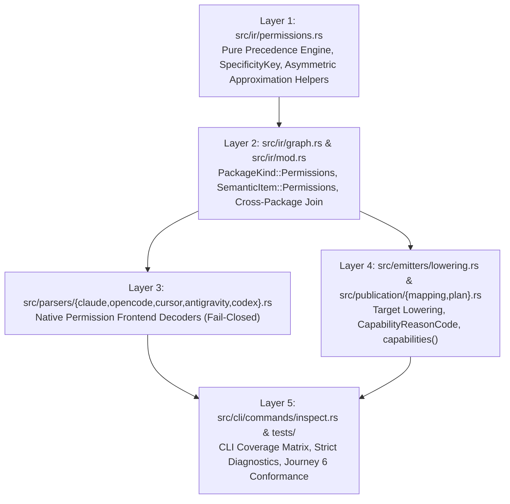

# Permission precedence and conflict-resolution design

## Context

`docs/2026-08-18-cli-ux-design.md` (Journey 6) identifies permission precedence as one of the three cross-cutting IR blockers preventing multi-entity governance across Rulette's five core harnesses (**Claude Code, OpenCode, Cursor, Antigravity, and Codex**).

Historically, `src/ir/mod.rs` defined `ToolAccessRule` as an underspecified triple:

```rust
pub struct ToolAccessRule {
    pub tool: String,
    pub pattern: Option<String>,
    pub action: Option<String>,
}
```

In the v0.1 compilation graph kernel (`src/ir/graph.rs`), native permission blocks are quarantined as `PackageKind::Unsupported` with `unsupported-semantic` diagnostics because `ToolAccessRule` lacked a deterministic conflict-resolution model, fail-closed lowering guarantees, and structured capability reporting.

### Empirical cross-harness permission survey

Each of the five core harnesses implements distinct rule-matching and conflict-resolution semantics:

| Harness | Native Config Surface | Native Actions | Native Conflict-Resolution & Matching Model | Key Limitations & Hazards |
| :--- | :--- | :--- | :--- | :--- |
| **Claude Code** (`claude`) | `.claude/settings.json` (project), `~/.claude/settings.json` (user), `.claude/settings.local.json` (local), `managed-settings.json` (enterprise) | `deny`, `ask`, `allow` + `defaultMode` | **Set-based category dominance**: checks `deny` first, then `ask`, then `allow`, then `defaultMode`. Rule order inside arrays is ignored. **Category strictly dominates specificity** (`deny: ["Bash(rm *)"]` blocks `allow: ["Bash(rm /tmp/a)"]`; `ask: ["Bash(git *)"]` overrides `allow: ["Bash(git status)"]`). | Wildcards before subcommands (`Bash(* rm)`) and parenthesized MCP args (`mcp__s__t(a)`) are invalid. Cannot carve an `allow` exception out of a broader `deny` or explicit `ask` rule. |
| **OpenCode** (`opencode`) | `opencode.json` / `.opencode/opencode.json` (`permission` map), `.opencode/agents/*.md` (`permission` frontmatter) | `"allow"`, `"ask"`, `"deny"` | **Sequential last-match-wins**: evaluates map entries in definition order; the **last matching pattern wins**. Does **not** score wildcard specificity and does **not** prioritize `deny` over `allow` automatically. | **Critical fail-open hazard**: emitting `"*": "allow"` or `"git *": "allow"` *after* `"rm *": "deny"` or `"git push *": "deny"` causes OpenCode to allow the denied command. Merges `write` and `edit` into a single `edit` key. |
| **Cursor** (`cursor`) | `.cursor/cli.json` (`permissions: { allow, deny }`) and `.cursor/permissions.json` (`terminalAllowlist`, `mcpAllowlist`) | `allow`, `deny` (`cli.json`); `allow`-only (`permissions.json`) | In `cli.json`, **`deny` strictly overrides `allow`**, and unmatched operations default to prompting (`ask`). Tokens are `Shell(cmd:*)`, `Read(glob)`, `Write(glob)`, `WebFetch(domain)`. | **No explicit `ask` list**: dropping an `ask` carve-out from a broader `allow` rule (e.g. `allow("bash", "git *")` + `ask("bash", "git push *")`) silently widens `allow` to auto-approve `git push`. |
| **Antigravity** (`antigravity`) | `.agents/settings.json` (project), `~/.gemini/settings.json` (user) (`permissions: { allow, ask, deny }`) | `allow`, `ask`, `deny` | **Specificity-sorted (`sortGrants` by descending target string length) + `deny > allow`**: evaluates `command(<prefix>)`, `read_file(<path>)`, `write_file(<path>)`, `mcp(<server>/<tool>)`, `read_url(<domain>)`. | **Wildcard ban**: generic `*` wildcards (`command(*)`, `read_file(*)`, `mcp(*)`, or glob patterns containing `*`) are rejected by the validator. |
| **Codex** (`codex`) | `.codex/rules/*.rules` (Starlark `prefix_rule(pattern=[...], decision=...)`); `AGENTS.md` is prose only | `"allow"`, `"prompt"`, `"forbidden"` | **Restrictive dominance**: `forbidden > prompt > allow` across all matching `prefix_rule` declarations regardless of specificity or order. | `prefix_rule` only governs tokenized shell command prefixes (`bash`), not file reads/writes or MCP tools. Lowering permissions into `AGENTS.md` prose provides zero mechanical enforcement. |

## Goals / Non-goals

**Goals:**

- Define a strongly-typed, canonical permission IR (`ToolAccessRule`, `PermissionAction`, `PermissionScope`, `CanonicalTool`, `NormalizedPattern`, `PermissionPolicy`, `TargetPermissionPolicy`) in `src/ir/permissions.rs` (re-exported via `src/ir/mod.rs` and `src/lib.rs`) and `PackageKind::Permissions` in `src/ir/graph.rs`.
- Define a deterministic conflict-resolution and precedence ordering across scope, action severity (`Deny > Ask > Allow`), pattern specificity (`SpecificityKey`), and lexicographical tie-breaking.
- Guarantee the **Fail-Safe Invariant**: permissions never fail open during parsing, normalization, cross-package merging, or target lowering.
- Establish the **4-Tier Canonical Ordering** so sequential `last-match-wins` targets (OpenCode) and set-based `Deny > Ask > Allow` targets (Claude, Codex, Cursor, Antigravity) evaluate to identical runtime decisions.
- Define how `Emitter::capabilities()` / `emitters::lowering::capabilities()` and `lower()` classify and report unrepresentable permission semantics (`Supported`, `Lossy`, `Dropped`) using stable machine-readable `CapabilityReasonCode` variants.
- Structure `tasks.md` and `.beads/formulas/permission-precedence-implementation.formula.toml` as an unambiguous blueprint for downstream implementation agents.

**Non-goals:**

- Synthesizing executable `PreToolUse` shell scripts to emulate unrepresentable permission globs (violates Rulette's static configuration compiler boundary).
- Lowering permissions into natural-language Markdown instructions (`AGENTS.md`, `CLAUDE.md`, `.mdc`, `SKILL.md`).
- Publishing `enterprise` or `local` scope files directly to host paths (remains forbidden by staged publication's scope allow-list; unsupported scopes report `Dropped` via `permission-scope-unrepresentable`).
- Designing the generalized hook event taxonomy (`rulette-5bk.12`) or MCP server tool-filtering (`rulette-5bk.13`) beyond `mcp` tool permission rules.

## Decisions

### 1. Strongly-typed permission IR and compilation graph integration

All permission domain types live in a pure library module `src/ir/permissions.rs` (with zero dependencies on CLI, I/O, or target emitters) and are re-exported from `src/ir/mod.rs`, `src/ir/graph.rs`, and `src/lib.rs`.

```rust
/// Canonical enforcement action for a tool access rule.
/// Ordered by restrictiveness: Allow (1) < Ask (2) < Deny (3).
#[derive(Clone, Copy, Debug, Eq, PartialEq, Ord, PartialOrd, Hash, Serialize, Deserialize, JsonSchema)]
#[serde(rename_all = "lowercase")]
pub enum PermissionAction {
    Allow,
    Ask,
    Deny,
}

impl PermissionAction {
    pub const fn restrictiveness(self) -> u8 {
        match self {
            Self::Allow => 1,
            Self::Ask => 2,
            Self::Deny => 3,
        }
    }

    /// Commutative, associative, idempotent fail-closed join (`Deny > Ask > Allow`).
    pub const fn join_restrictive(self, other: Self) -> Self {
        if self.restrictiveness() >= other.restrictiveness() {
            self
        } else {
            other
        }
    }
}

/// Configuration authority tier for a permission rule or policy.
/// Ordered from lowest authority to highest authority: User (1) < Project (2) < Local (3) < Enterprise (4).
#[derive(Clone, Copy, Debug, Default, Eq, PartialEq, Ord, PartialOrd, Hash, Serialize, Deserialize, JsonSchema)]
#[serde(rename_all = "lowercase")]
pub enum PermissionScope {
    User,
    #[default]
    Project,
    Local,
    Enterprise,
}

impl PermissionScope {
    pub const fn rank(self) -> u8 {
        match self {
            Self::User => 1,
            Self::Project => 2,
            Self::Local => 3,
            Self::Enterprise => 4,
        }
    }
}

/// Canonical portable tool access rule.
#[derive(Clone, Debug, Eq, PartialEq, Serialize, Deserialize, JsonSchema)]
#[serde(deny_unknown_fields)]
pub struct ToolAccessRule {
    pub tool: String,
    #[serde(skip_serializing_if = "Option::is_none")]
    pub pattern: Option<String>,
    pub action: PermissionAction,
    #[serde(default, skip_serializing_if = "Option::is_none")]
    pub scope: Option<PermissionScope>,
}
```

**Why `action` is required `PermissionAction` rather than `Option<String>`:**
If `action` were optional or untyped, an omitted or misspelled action could be misinterpreted as permissive. Making `action: PermissionAction` required at the serde boundary guarantees that missing, null, or unrecognized actions fail deserialization before a graph is constructed.

**Tool normalization (`CanonicalTool`):**
`ToolAccessRule.tool` is normalized by trimming and ASCII-lowercasing, mapping harness-specific spellings onto canonical tool categories while preserving unknown custom tool identifiers for capability reporting:

| Canonical Tool Token | Recognized Native Aliases | Pattern Domain |
| :--- | :--- | :--- |
| `"*"` (`CanonicalTool::All`) | `"*"`, `"all"` | Universal catch-all (`pattern` must be `None` or `"*"`) |
| `"bash"` (`CanonicalTool::Bash`) | `"bash"`, `"Bash"`, `"Shell"`, `"command"`, `"run_command"` | Command string / token prefix (`"git status"`, `"git *"`, `"npm run *"`) |
| `"read"` (`CanonicalTool::Read`) | `"read"`, `"Read"`, `"read_file"`, `"view_file"` | Relative or home-anchored file path glob (`"src/**"`, `"**/.env*"`) |
| `"edit"` (`CanonicalTool::Edit`) | `"edit"`, `"Edit"`, `"replace_file_content"` | Relative or home-anchored file path glob (`"src/**/*.rs"`) |
| `"write"` (`CanonicalTool::Write`) | `"write"`, `"Write"`, `"write_file"`, `"write_to_file"` | Relative or home-anchored file path glob (`"dist/**"`, `"**/.env*"`) |
| `"webfetch"` (`CanonicalTool::WebFetch`) | `"webfetch"`, `"WebFetch"`, `"read_url"`, `"read_url_content"` | Domain or URL pattern (`"example.com"`, `"*.example.com"`) |
| `"websearch"` (`CanonicalTool::WebSearch`) | `"websearch"`, `"WebSearch"`, `"search_web"` | Query or universal pattern (`"*"`) |
| `"glob"` (`CanonicalTool::Glob`) | `"glob"`, `"Glob"` | Path glob pattern |
| `"grep"` (`CanonicalTool::Grep`) | `"grep"`, `"Grep"` | Path/regex pattern |
| `"list"` (`CanonicalTool::List`) | `"list"`, `"List"` | Directory path pattern |
| `"agent"` (`CanonicalTool::Agent`) | `"agent"`, `"Agent"`, `"task"`, `"invoke_subagent"` | Subagent name or model specifier (`"reviewer"`, `"model:opus"`) |
| `"skill"` (`CanonicalTool::Skill`) | `"skill"`, `"Skill"` | Skill name pattern |
| `"external_directory"` (`CanonicalTool::ExternalDirectory`) | `"external_directory"`, `"additionalDirectories"` | External directory path (`"../shared/**"`, `"/opt/schemas"`) |
| `"mcp"` (`CanonicalTool::Mcp`) | `"mcp"`, `"mcp__<s>__<t>"`, `"<s>:<t>"`, `"mcp(<s>/<t>)"` | Normalized `<server>/<tool>` or `<server>/*` or `*/*` |
| `CanonicalTool::Custom(String)` | Any other non-empty control-free identifier | Preserved verbatim; triggers `permission-tool-unrepresentable` on targets that cannot express it |

**Per-target overrides (`TargetPermissionPolicy`):**
Mirroring `TargetActivation` (`src/ir/graph.rs`), `PermissionPolicy` supports optional per-target full-replacement overrides:

```rust
#[derive(Clone, Debug, Default, Eq, PartialEq, Serialize, Deserialize, JsonSchema)]
#[serde(deny_unknown_fields)]
pub struct PermissionPolicy {
    #[serde(default, skip_serializing_if = "Option::is_none")]
    pub default_mode: Option<PermissionAction>,
    #[serde(default, skip_serializing_if = "Vec::is_empty")]
    pub rules: Vec<ToolAccessRule>,
}

#[derive(Clone, Debug, Eq, PartialEq, Serialize, Deserialize, JsonSchema)]
#[serde(deny_unknown_fields)]
pub struct TargetPermissionOverrides {
    pub default: PermissionPolicy,
    #[serde(default, skip_serializing_if = "BTreeMap::is_empty")]
    pub overrides: BTreeMap<String, PermissionPolicy>,
}

#[derive(Clone, Debug, Eq, PartialEq, Serialize, Deserialize, JsonSchema)]
#[serde(untagged)]
pub enum TargetPermissionPolicy {
    Wrapped(TargetPermissionOverrides),
    Bare(PermissionPolicy),
}
```

Resolution uses the exact same lookup precedence as `TargetActivation::resolve`: exact target token (`"claude"`, `"opencode"`, `"cursor"`, `"antigravity"`, `"codex"`), then normalized family prefix (`"cursor"` for `"cursor-mdc"` / `"cursor-cli"`), then `default`.

**Compilation graph integration (`src/ir/graph.rs`):**

- `PackageKind` gains `Permissions` (`"permissions"`).
- `SemanticIdentity` accepts `"permissions:<logical-name>"` alongside `"rule"`, `"skill"`, and `"unsupported"`.
- `SemanticItem` gains:

  ```rust
  Permissions {
      policy: TargetPermissionPolicy,
      #[serde(skip_serializing_if = "Option::is_none")]
      frontend_payload: Option<FrontendPayload>,
  }
  ```

- `package_id` hashes the canonical JSON serialization of `policy` in addition to the package's resources, ensuring any change to a `ToolAccessRule` deterministically changes the `PackageId` digest.

---

### 2. Deterministic conflict-resolution and 4-tier total precedence ordering

#### 2a. Pattern normalization and the 6-tuple `SpecificityKey`

Every `ToolAccessRule.pattern` is normalized before comparison:

1. `None`, `Some("")`, `Some("*")`, or `Some("**")` normalizes to `NormalizedPattern::Universal` (rendered as `"*"`).
2. Tool-embedded specifiers (such as Claude's `"Bash(git diff *)"`, `"WebFetch(domain:example.com)"`, `"mcp__github__get_issue"`, Cursor's `"Shell(git:*)"`, or Antigravity's `"command(git status)"`) are canonicalized into `(CanonicalTool, NormalizedPattern)` during parsing or normalization (e.g., `tool: "bash", pattern: "git diff *"`, `tool: "webfetch", pattern: "example.com"`, `tool: "mcp", pattern: "github/get_issue"`).
3. Redundant consecutive wildcards (`"**/**"` or `"**"`) in non-path domains and surrounding whitespace are canonicalized; control characters (`char::is_control`) are rejected as validation errors.

Each normalized `(CanonicalTool, NormalizedPattern)` is assigned a deterministic 6-tuple `SpecificityKey`, compared lexicographically from left to right (higher value = more specific):

```rust
#[derive(Clone, Copy, Debug, Eq, PartialEq, Ord, PartialOrd, Hash)]
pub enum SpecificityClass {
    /// `*` or omitted pattern — matches all arguments of the tool.
    UniversalWildcard = 1,
    /// Starts with a wildcard (`*` or `?`) followed by literals, e.g. `*.env`, `**/.env*`, `* --help`.
    UnanchoredGlob = 2,
    /// Starts with at least one literal character before any wildcard, e.g. `git *`, `src/**/*.rs`, `github/*`.
    AnchoredPrefix = 3,
    /// Contains zero wildcard characters (`*`, `?`, `[`), e.g. `git status`, `src/main.rs`, `github/get_issue`.
    Exact = 4,
}

#[derive(Clone, Copy, Debug, Eq, PartialEq, Ord, PartialOrd, Hash)]
pub struct SpecificityKey {
    /// 1. Named tool (`true`, e.g. `bash`) beats universal wildcard tool (`false`, `*`).
    pub tool_is_exact: bool,
    /// 2. Pattern structural class (`UniversalWildcard = 1` .. `Exact = 4`).
    pub class: SpecificityClass,
    /// 3. Byte length of the leading literal prefix before the first `*`, `?`, or `[`.
    pub leading_literal_len: usize,
    /// 4. Number of non-empty path (`/`) or command-token (whitespace) segments containing literal characters.
    pub literal_segment_count: usize,
    /// 5. Total number of non-wildcard UTF-8 bytes in the normalized pattern.
    pub total_literal_len: usize,
    /// 6. Fewer wildcard characters wins when literal lengths are equal (`Reverse<usize>`).
    pub negated_wildcard_count: std::cmp::Reverse<usize>,
}
```

Concrete specificity ordering examples:

- `("bash", "git status")` (`Exact`, `leading=10`) $\succ$ `("bash", "git push --force *")` (`AnchoredPrefix`, `leading=17`) $\succ$ `("bash", "git push *")` (`AnchoredPrefix`, `leading=9`) $\succ$ `("bash", "git *")` (`AnchoredPrefix`, `leading=4`) $\succ$ `("bash", "* --version")` (`UnanchoredGlob`, `leading=0`) $\succ$ `("bash", "*")` (`UniversalWildcard`) $\succ$ `("*", "*")` (`tool_is_exact=false`).
- `("read", "src/api/auth.rs")` (`Exact`) $\succ$ `("read", "src/api/**/*.rs")` (`AnchoredPrefix`, `leading=8`) $\succ$ `("read", "src/**/*.rs")` (`AnchoredPrefix`, `leading=4`) $\succ$ `("read", "**/.env.local")` (`UnanchoredGlob`, `total_literal=11`) $\succ$ `("read", "**/.env*")` (`UnanchoredGlob`, `total_literal=5`) $\succ$ `("read", "*")` (`UniversalWildcard`).

#### 2b. Exact-key conflict resolution (Same `(CanonicalTool, NormalizedPattern)`)

When multiple `ToolAccessRule` entries (within a single policy or across merged `Permissions` packages) normalize to the **exact same `(CanonicalTool, NormalizedPattern)`**:

1. **Fail-Closed `Deny` Dominance**: If *any* rule for `(tool, pattern)` at any scope has `action == PermissionAction::Deny`, the resolved action is unconditionally `PermissionAction::Deny`. A `Deny` rule can never be weakened to `Ask` or `Allow` by another rule or scope.
2. **Scope Precedence (`Enterprise > Local > Project > User`)**: Among non-`Deny` rules (`Ask` vs `Allow`) from different scopes, the rule with the higher `PermissionScope::rank()` wins, **except** when a higher-precedence `Ask` or `Deny` exists at equal or higher scope.
3. **Action Precedence (`Deny > Ask > Allow`)**: At the same `PermissionScope`, the more restrictive action (`PermissionAction::join_restrictive`) wins:
   $$\text{Deny} \; (3) \succ \text{Ask} \; (2) \succ \text{Allow} \; (1)$$
4. **Deterministic Tie-Breaking**: Provenance attribution for the winning rule is selected deterministically by the smallest tie-break tuple `(source_package_semantic_identity, source_package_id, original_rule_index)` in standard UTF-8 byte order (`Ord`).

#### 2c. Cross-pattern conflict resolution and the 4-Tier Canonical Ordering

Across distinct patterns on the same tool, naive specificity-only ordering and naive action-only ordering both fail in real-world scenarios:

- **Why pure specificity-only fails open**: Suppose a policy contains `deny("bash", "rm *")` (`AnchoredPrefix`) and `allow("bash", "* --dry-run")` (`UnanchoredGlob`) or `allow("bash", "rm /tmp/cache")` (`Exact`). Under specificity-only ordering, `rm /tmp/cache` or a partial overlap would evaluate to `Allow`, violating Claude Code, Codex, and Cursor's hard `Deny > Allow` semantics and creating a command-injection bypass (`rm -rf / --dry-run`).
- **Why pure action-only fails on universal defaults**: Suppose a policy sets a universal baseline `ask("bash", "*")` and a specific grant `allow("bash", "git status")`. If universal `"*"` `Ask` beat specific `Allow`, no `Allow` rule could ever take effect under a default-ask policy.

To resolve both without ambiguity, Rulette partitions every normalized rule into a **4-Tier Canonical Precedence Hierarchy** (ordered from lowest precedence `Tier 1` to highest precedence `Tier 4`):

```text
Tier 1 (Lowest Precedence): UniversalBaseline
  - Rules where pattern == Universal ("*") and action in {Allow, Ask}.
  - Within Tier 1: tool_is_exact (false < true), then Action (Allow < Ask).

Tier 2: SpecificAllow
  - Rules where pattern != Universal ("*") and action == Allow.
  - Ordered by ascending (SpecificityKey, canonical_tool, normalized_pattern, TieBreakKey).

Tier 3: SpecificAsk
  - Rules where pattern != Universal ("*") and action == Ask.
  - Ordered by ascending (SpecificityKey, canonical_tool, normalized_pattern, TieBreakKey).

Tier 4 (Highest Precedence): HardDeny
  - All rules where action == Deny (both Universal "*" and specific patterns).
  - Ordered by ascending (SpecificityKey, canonical_tool, normalized_pattern, TieBreakKey).
```

**How runtime evaluation works under the 4-Tier Hierarchy:**
For any tool invocation $(t, \text{arg})$, the effective decision is the **highest-tier matching rule** (or `default_mode` / `PermissionAction::Ask` if no rule matches):
$$\text{Match}(\text{Tier 4: HardDeny}) \implies \text{Deny}$$
$$\text{else Match}(\text{Tier 3: SpecificAsk}) \implies \text{Ask}$$
$$\text{else Match}(\text{Tier 2: SpecificAllow}) \implies \text{Allow}$$
$$\text{else Match}(\text{Tier 1: UniversalBaseline}) \implies \text{Tier 1 Action}$$
$$\text{else} \implies \text{default\_mode}.\text{unwrap\_or}(\text{PermissionAction::Ask})$$

**Why this 4-Tier Hierarchy unifies all five harnesses:**

1. **Set-based `Deny > Ask > Allow` targets (Claude Code, Codex `execpolicy`, Cursor CLI, Antigravity)**:
   - Tier 4 maps to `deny` / `forbidden`.
   - Tier 3 maps to `ask` / `prompt`.
   - Tier 2 maps to `allow`.
   - Tier 1 (`UniversalBaseline`) maps to `defaultMode` (in Claude Code) or universal tool rules.
   - Because these runtimes check `deny` then `ask` then `allow` then `defaultMode`, their native evaluation matches `Tier 4 > Tier 3 > Tier 2 > Tier 1` **exactly**!
2. **Sequential `last-match-wins` targets (OpenCode)**:
   - OpenCode evaluates keys top-to-bottom and picks the **last** matching key.
   - By emitting OpenCode permission keys in ascending tier order (**`Tier 1` first $\to$ `Tier 2` second $\to$ `Tier 3` third $\to$ `Tier 4` last**), the **last** matching key in OpenCode is guaranteed to come from the highest matching tier (`Tier 4 > Tier 3 > Tier 2 > Tier 1`)!
   - Consequently, a `Deny` rule in Tier 4 is always emitted *after* all `Allow` and `Ask` rules in OpenCode, so no `Allow` rule (no matter how specific or overlapping) can ever override a `Deny` rule in OpenCode!

#### 2d. Shadowed permissive rule detection (`subsumes`)

What if a user authors a narrower rule in a lower tier that is completely covered by a broader rule in a higher tier — for example:

- `deny("bash", "git *")` (Tier 4) alongside `allow("bash", "git status")` (Tier 2), or
- `ask("bash", "git *")` (Tier 3) alongside `allow("bash", "git status")` (Tier 2)?

In `src/ir/permissions.rs`, `NormalizedPattern::subsumes(&self, narrower: &Self) -> bool` checks whether `self` structurally covers all strings matched by `narrower`:

- `Universal` (`"*"`) subsumes every pattern on the same tool (and tool `"*"` subsumes every tool).
- `AnchoredPrefix(p1)` (where `p1` is a literal prefix followed by a single trailing `*`, e.g. `"git *"`) subsumes `Exact(s)` if `s.starts_with(p1_prefix)` and subsumes `AnchoredPrefix(p2)` if `p2_prefix.starts_with(p1_prefix)`.
- Equal patterns subsume each other.

When a higher-tier rule $R_{\text{high}} \in \text{Tier } 3 \cup \text{Tier } 4$ subsumes a lower-tier rule $R_{\text{low}} \in \text{Tier } 1 \cup \text{Tier } 2 \cup \text{Tier } 3$ (with $\text{tier}(R_{\text{high}}) > \text{tier}(R_{\text{low}})$):

1. The effective decision for any input matching $R_{\text{low}}$ is governed by $R_{\text{high}}$ (**fail-closed**: `Deny` or `Ask`, never `Allow`).
2. $R_{\text{low}}$ is pruned from active emission and recorded in `ResolvedPermissionPolicy::shadowed_rules` as a `ShadowedPermissionRule` entry.
3. During lowering and capability analysis, each package containing a shadowed rule produces a `CapabilitySeverity::Lossy` finding with `CapabilityReasonCode::PermissionPrecedenceUnrepresentable` (`"permission-precedence-unrepresentable"`), explaining which higher-tier rule shadowed it. Under strict mode (`allow_lossy: false`), compilation rejects the ambiguous/shadowed configuration; under `--allow-lossy`, compilation proceeds with the fail-closed effective policy.

---

### 3. Fail-safe invariant and the Asymmetric Approximation Law

Rulette enforces six hard fail-safe invariants across all permission operations:

1. **Invariant 1 — Parse-Time Fail-Closed**:
   Missing, empty, null, or unrecognized `action` strings, empty `tool` strings, or control characters in `tool`/`pattern` are fatal parse/validation errors. Unknown actions never default to `Allow` or `Ask`.
2. **Invariant 2 — Zero Advisory Markdown Lowering**:
   `ToolAccessRule` and `PackageKind::Permissions` are mechanical access controls and SHALL NEVER be rendered as natural-language prose in `AGENTS.md`, `CLAUDE.md`, `.cursor/rules/*.mdc`, `.agents/rules/*.md`, or `SKILL.md`.
3. **Invariant 3 — Never Widen an `Allow` Rule (Asymmetric Approximation — Part A)**:
   If a target backend cannot represent the `pattern` or `tool` of an `Allow` rule (e.g., `allow("bash", "git *")` on Antigravity where `*` wildcards are banned, or `allow("bash", "git * main")` on Claude Code where mid-string wildcards are invalid), the backend MUST NOT strip the pattern to a broader prefix or bare tool name. In strict mode, lowering fails; under `--allow-lossy`, the unrepresentable `Allow` rule is **withheld (dropped from emitted output)** so the target falls back to prompting or denying.
4. **Invariant 4 — Never Drop a `Deny` Rule That Unblocks an Overlapping `Allow` Rule (Asymmetric Approximation — Part B)**:
   If a `Deny` rule is unrepresentable on a target (e.g., Antigravity rejects `deny("bash", "git push *")` due to the `*` wildcard, or Cursor `cli.json` rejects a tool category), and the resolved policy also contains an `Allow` rule that overlaps with (`NormalizedPattern::overlaps`) that `Deny` rule (such as `allow("bash", "git status")` or `allow("bash", "git *")`):
   - In strict mode (`allow_lossy: false`), lowering fails immediately.
   - Under `--allow-lossy` (`allow_lossy: true`), the backend MUST either:
     - Widen the `Deny` pattern to the nearest target-representable superset prefix (e.g., `command(git push)` in Antigravity or `prefix_rule(["git", "push"], "forbidden")` in Codex, which is fail-closed), OR
     - **Withhold (revoke) every overlapping `Allow` rule** from the emitted target artifact so the target cannot auto-approve the denied action!
5. **Invariant 5 — Promote Unrepresentable `Ask` Carve-Outs to `Deny` (Asymmetric Approximation — Part C)**:
   When lowering to a target that supports `Allow` and `Deny` but has no explicit `Ask` list (Cursor `.cursor/cli.json`):
   - In strict mode (`allow_lossy: false`), any `Ask` rule fails lowering with `PermissionActionUnrepresentable`.
   - Under `--allow-lossy` (`allow_lossy: true`):
     - If an `Ask` rule overlaps with any emitted `Allow` rule on the same tool (for example, `allow("bash", "git *")` with a carve-out `ask("bash", "git push *")`), omitting the `Ask` rule would cause `git push` to match `allow("bash", "git *")` and execute without confirmation (**fail-open**!). Therefore, the backend MUST **promote the overlapping `Ask` rule to `Deny`** in `.cursor/cli.json` (`"deny": ["Shell(git:push*)"]`) and emit a `CapabilitySeverity::Lossy` finding with `CapabilityReasonCode::PermissionAskPromotedToDeny` (`"permission-ask-promoted-to-deny"`).
     - If a standalone `Ask` rule does not overlap with any `Allow` rule (so Cursor CLI's default unmatched behavior already prompts the user), it is omitted from `.cursor/cli.json` and reported as `CapabilitySeverity::Lossy` with `CapabilityReasonCode::PermissionActionUnrepresentable`.
6. **Invariant 6 — Fail-Closed Tool-Collapse Join**:
   When a target merges multiple canonical tools into one native tool key (specifically, OpenCode `edit`, Cursor `Write`, and Antigravity `write_file` merge canonical `"edit"` and `"write"`), rules for `"edit"` and `"write"` that map to the same native pattern are combined using `PermissionAction::join_restrictive` (`Deny > Ask > Allow`). If `"edit"` and `"write"` specify different actions for the same pattern (e.g., `allow("edit", "src/**")` and `deny("write", "src/**")`), the target receives the more restrictive action (`Deny`) and reports a `Lossy` finding (`PermissionPrecedenceUnrepresentable`).

---

### 4. Capability reporting (`Emitter::capabilities()` / `emitters::lowering`) and target matrix

#### 4a. Capability API and reason codes

In `src/emitters/lowering.rs`, capability classification is exposed both through `lower(graph, target, options) -> Result<LoweringPlan>` and through a dedicated pure query function:

```rust
/// Computes deterministic per-package and per-resource capability findings
/// for `target` without failing on strict loss or writing files.
pub fn capabilities(
    graph: &CompilationGraph,
    target: NativeTarget,
) -> Result<Vec<CapabilityFinding>> {
    Ok(lower(graph, target, LoweringOptions::allow_lossy())?.findings)
}
```

This guarantees by construction that `inspect --to <target>`, `inspect --coverage`, and `transform` always observe the exact same `CapabilityFinding` set.

`CapabilityReasonCode` in `src/emitters/lowering.rs` (and `src/publication/plan.rs`) is extended with seven stable permission reason codes:

| Variant | Wire String | Severity | Trigger Condition |
| :--- | :--- | :--- | :--- |
| `PermissionTargetUnsupported` | `"permission-target-unsupported"` | `Dropped` | Target has no native permission configuration format (e.g. `agent-plugin`). |
| `PermissionScopeUnrepresentable` | `"permission-scope-unrepresentable"` | `Dropped` | Rule or policy specifies `enterprise` or `local` scope, or `user` scope on a target without user mapping (`cursor`, `agent-plugin`). |
| `PermissionToolUnrepresentable` | `"permission-tool-unrepresentable"` | `Lossy` / `Dropped` | Rule references a tool that the target's permission schema cannot express (e.g. `mcp` or `read` in Codex `.rules`; `mcp` or `websearch` in Cursor `cli.json`). |
| `PermissionActionUnrepresentable` | `"permission-action-unrepresentable"` | `Lossy` / `Dropped` | Rule uses an action state (`Ask` or `Deny`) not natively supported by the target without overlapping an `Allow` carve-out. |
| `PermissionAskPromotedToDeny` | `"permission-ask-promoted-to-deny"` | `Lossy` | Under `--allow-lossy`, an `Ask` carve-out overlapping an `Allow` rule is promoted to `Deny` on an `Allow`/`Deny`-only target (Cursor `cli.json`). |
| `PermissionPatternUnrepresentable` | `"permission-pattern-unrepresentable"` | `Lossy` / `Dropped` | Rule pattern uses syntax unsupported by the target (e.g. `*` wildcard in Antigravity grants, mid-command wildcard in Claude `Bash`, non-prefix glob in Codex `prefix_rule`). |
| `PermissionPrecedenceUnrepresentable` | `"permission-precedence-unrepresentable"` | `Lossy` | Policy contains a shadowed permissive rule (`Allow` under broader `Deny`/`Ask`), a fail-closed tool-collapse join (`edit` vs `write`), or a withheld `Allow` overlapped by an unrepresentable `Deny`. |

**Package-level vs. rule-level aggregation:**
Following the pattern established in `rule-field-loss-findings`:

- At most **one finding per `(package_id, target, reason_code)`** is emitted, aggregating all affected rules in deterministic canonical rule order (`"<tool>(<pattern>): <action>"`) in the `reason` string.
- If **zero** rules in a `Permissions` package produce emitted target bytes (and `default_mode` is not emitted), the package-level finding severity is `CapabilitySeverity::Dropped` and no empty permission artifact is emitted.
- If **at least one** rule (or `default_mode`) is emitted while one or more rules are withheld, promoted, or shadowed, the finding severity is `CapabilitySeverity::Lossy` and references the emitted `artifact_path`.
- If **all** rules in the `Permissions` package are represented faithfully without shadowing, withholding, or promotion, a `CapabilitySeverity::Supported` (`CapabilityReasonCode::Representable`) finding is recorded with the emitted `artifact_path`.

#### 4b. Target artifact classes and publication mappings

`NativeArtifactClass` in `src/emitters/lowering.rs` gains `PermissionConfig` (`"permission-config"`).
In `src/publication/mapping.rs`, verified `PermissionConfig` rules are added to the compiled-in mapping tables:

| Target | Project Scope Mapping (`PublicationScope::Project`) | User Scope Mapping (`PublicationScope::User`) |
| :--- | :--- | :--- |
| **Claude** (`claude`) | `native: "settings.json"` $\to$ `mapped: ".claude/settings.json"` | `native: "settings.json"` $\to$ `mapped: "settings.json"` (under `~/.claude`) |
| **OpenCode** (`opencode`) | `native: "opencode.json"` $\to$ `mapped: "opencode.json"` | `native: "opencode.json"` $\to$ `mapped: "opencode.json"` (under `~/.config/opencode`) |
| **Cursor** (`cursor`) | `native: "cli.json"` $\to$ `mapped: ".cursor/cli.json"` | Unavailable (existing error: `"user mapping is unavailable for target cursor"`) |
| **Antigravity** (`antigravity`) | `native: "settings.json"` $\to$ `mapped: ".agents/settings.json"` | `native: "settings.json"` $\to$ `mapped: "settings.json"` (under `~/.gemini`) |
| **Codex** (`codex`) | `native: "rules/rulette.rules"` $\to$ `mapped: ".codex/rules/rulette.rules"` | `native: "rules/rulette.rules"` $\to$ `mapped: "rules/rulette.rules"` (under `~/.codex`) |
| **AgentPlugin** (`agent-plugin`) | Unsupported (`PermissionTargetUnsupported` $\to$ `Dropped`) | Unavailable |

---

### 5. Module layering and downstream execution blueprint

To ensure downstream implementation by smaller models is modular, verifiable, and free of circular dependencies, the architecture is strictly layered:



A dedicated Beads workflow formula is provided in `.beads/formulas/permission-precedence-implementation.formula.toml` so orchestrators or agents can execute each layer as an isolated, test-gated step.

---

## Independent adversarial review record

Mandatory adversarial review was conducted against the precedence and lowering design prior to staging implementation tasks. Seven attack vectors and edge cases were identified and resolved in the design:

1. **Attack Vector 1 — OpenCode sequential `last-match-wins` inversion (Fail-Open via Key Order)**:
   - *Vulnerability*: OpenCode evaluates `"permission"` patterns sequentially and uses the last matching key. If an emitter serializes maps in standard alphabetical key order (`BTreeMap<String, PermissionAction>`), `"*": "allow"` or `"git *": "allow"` is sorted *before* or *after* patterns purely by ASCII code (`'*' (0x2A) < 'g' (0x67) < 'r' (0x72)`), meaning `"git *": "allow"` appears *after* `"* --force": "deny"`, allowing `git push --force`!
   - *Mitigation*: OpenCode permission maps MUST NOT use alphabetical `BTreeMap` serialization for pattern keys. They are serialized as an ordered `Vec<(String, PermissionAction)>` (via `serde_json::Map` preserving insertion order or custom `SerializeStruct`/`SerializeMap`) in strict **4-Tier Ascending Precedence Order** (`Tier 1: UniversalBaseline` $\to$ `Tier 2: SpecificAllow` $\to$ `Tier 3: SpecificAsk` $\to$ `Tier 4: HardDeny`). Because all `Deny` rules are emitted in Tier 4 at the end of the map, no `Allow` or `Ask` rule can ever override a matching `Deny` rule in OpenCode.

2. **Attack Vector 2 — Partial glob intersection bypass (`rm *` vs `* --help`)**:
   - *Vulnerability*: Two patterns on the same tool (`deny("bash", "rm *")` and `allow("bash", "* --help")`) are incomparable under prefix subsetting, yet both match `rm -rf / --help`.
   - *Mitigation*: Under the 4-Tier Hierarchy, `HardDeny` (Tier 4) strictly dominates `SpecificAsk` (Tier 3), which strictly dominates `SpecificAllow` (Tier 2). Any command matching both an `Allow` pattern and an `Ask` or `Deny` pattern is evaluated at the highest matching tier (`Deny > Ask > Allow`), failing closed in both set-based and sequential targets.

3. **Attack Vector 3 — Cursor `Ask` carve-out omission widening an `Allow` rule**:
   - *Vulnerability*: Cursor `.cursor/cli.json` supports only `allow` and `deny`. If a policy grants `allow("bash", "git *")` and carves out `ask("bash", "git push *")`, simply dropping the unrepresentable `Ask` rule under `--allow-lossy` leaves `allow: ["Shell(git:*)"]` active without restriction, auto-approving `git push` without prompting.
   - *Mitigation*: Invariant 5 (Asymmetric Approximation — Part C) requires that under `--allow-lossy`, any `Ask` rule whose pattern overlaps (`NormalizedPattern::overlaps`) an emitted `Allow` rule on an `Allow`/`Deny`-only target is **promoted to `Deny`** and reported with `CapabilityReasonCode::PermissionAskPromotedToDeny`.

4. **Attack Vector 4 — Unrepresentable `Deny` dropped while overlapping `Allow` survives (Antigravity / Codex / Cursor)**:
   - *Vulnerability*: Suppose a policy contains `allow("bash", "git status")` (exact, valid in Antigravity) and `deny("bash", "git *")` (contains `*` wildcard, rejected by Antigravity's grant validator). If Antigravity dropped the unrepresentable wildcard `Deny` under `--allow-lossy` while emitting `command(git status)` in `permissions.allow`, it would fail open!
   - *Mitigation*: First, canonical shadowing analysis (Decision 2d) already prunes `allow("bash", "git status")` because it is subsumed by `deny("bash", "git *")`. Second, even for non-subsumed partial overlaps (e.g. `allow("bash", "git status")` vs an unrepresentable `deny("bash", "*status")`), Invariant 4 requires the backend to withhold any `Allow` rule that overlaps an unrepresentable `Deny` rule unless the `Deny` rule can be safely widened to a target-representable superset prefix (e.g. `command(git)`).

5. **Attack Vector 5 — Tool-collapse conflict between `edit` and `write` in OpenCode, Cursor, and Antigravity**:
   - *Vulnerability*: Claude distinguishes `Edit` (modifying existing files) from `Write` (creating/overwriting files). OpenCode (`edit`), Cursor (`Write`), and Antigravity (`write_file`) combine both into a single tool primitive. If a policy sets `allow("edit", "src/**")` and `deny("write", "src/**")`, naive last-write-wins during tool mapping could emit `allow("edit", "src/**")`, allowing unrestricted file creation/overwrite.
   - *Mitigation*: Invariant 6 mandates that when multiple canonical tools map to the same target tool key and pattern, their actions are combined via `PermissionAction::join_restrictive` (`Deny > Ask > Allow`), and any conflict between merged tools emits a `CapabilitySeverity::Lossy` finding (`PermissionPrecedenceUnrepresentable`).

6. **Attack Vector 6 — Lowering mechanical permissions into Codex `AGENTS.md` prose**:
   - *Vulnerability*: Emitting `"Never execute rm -rf"` into `AGENTS.md` when targeting `codex` gives operators a false sense of security while leaving the agent runtime unconstrained.
   - *Mitigation*: Invariant 2 forbids rendering `ToolAccessRule` into Markdown instructions. Codex permission lowering targets only mechanical Starlark `.codex/rules/rulette.rules` (`prefix_rule`) for representable `bash` prefix rules and reports `PermissionToolUnrepresentable` / `PermissionPatternUnrepresentable` for all other rules.

7. **Attack Vector 7 — Input-order sensitivity when merging multiple `Permissions` packages**:
   - *Vulnerability*: If a repository or archive contains multiple permission sources (e.g., `.claude/settings.json` and agent permission blocks), merging them in discovery order could make the output depend on filesystem walk order.
   - *Mitigation*: Cross-package merging (`merge_permission_packages`) forms a commutative, associative, idempotent join-semilattice over `(CanonicalTool, NormalizedPattern)` with `PermissionAction::join_restrictive` (`Deny > Ask > Allow`) and sorts all output rules by the total 4-Tier key plus `(canonical_tool, normalized_pattern, package_semantic_identity, package_id)`.

## Risks / Trade-offs

- **[Trade-off] Strict rejection of permissive carve-outs (`Allow` under broader `Deny` or non-universal `Ask`)**:
  - Authors migrating hand-written OpenCode configs that rely on placing a specific `"git status": "allow"` *after* a broad `"git *": "deny"` will receive a `permission-precedence-unrepresentable` loss finding and fail strict compilation.
  - *Mitigation*: This is an intentional safety feature — `Allow`-under-`Deny` is unrepresentable in Claude Code, Cursor CLI, and Codex `execpolicy`, and fails open on partial overlaps. The diagnostic message explicitly advises refactoring the broad `Deny` into targeted `Deny` rules or using `TargetPermissionPolicy` (`overrides.opencode`) when tool-specific behavior is desired.
- **[Trade-off] Antigravity wildcard ban causes `Lossy`/`Dropped` findings for glob-heavy policies**:
  - Because Antigravity's grant validator rejects `*` in `command(...)` and `read_file(...)`, policies using `read("src/**/*.rs")` cannot be lowered losslessly to Antigravity `settings.json`.
  - *Mitigation*: Reported cleanly via `permission-pattern-unrepresentable`; users can supply prefix-based `overrides.antigravity` in `TargetPermissionPolicy` for lossless multi-target fan-out.

## Validation

- Unit tests in `src/ir/permissions.rs` verify `SpecificityKey` ordering, `NormalizedPattern::subsumes` and `overlaps`, 4-Tier sorting, exact-key `Deny > Ask > Allow` resolution, shadowing detection, tool-alias normalization, and permutation invariance.
- Reference-evaluator equivalence tests in `src/ir/permissions.rs` and `src/emitters/lowering.rs` verify that for any resolved policy and synthetic invocation corpus, OpenCode's sequential last-match-wins evaluation over the emitted 4-Tier map produces the **exact same** `PermissionAction` as Claude Code's set-based `Deny > Ask > Allow` evaluator.
- Backend lowering tests in `src/emitters/lowering.rs` verify strict rejection and `--allow-lossy` fail-closed behavior for all seven `CapabilityReasonCode` variants across Claude, OpenCode, Cursor, Antigravity, Codex, and AgentPlugin.
- End-to-end CLI tests in `tests/` verify `inspect --coverage`, `inspect --to`, staged plan loss serialization, and Journey 6 multi-target governance fan-out.
- Run `mise run spec-validate` and `mise run check` to verify strict OpenSpec compliance and repository quality gates.
