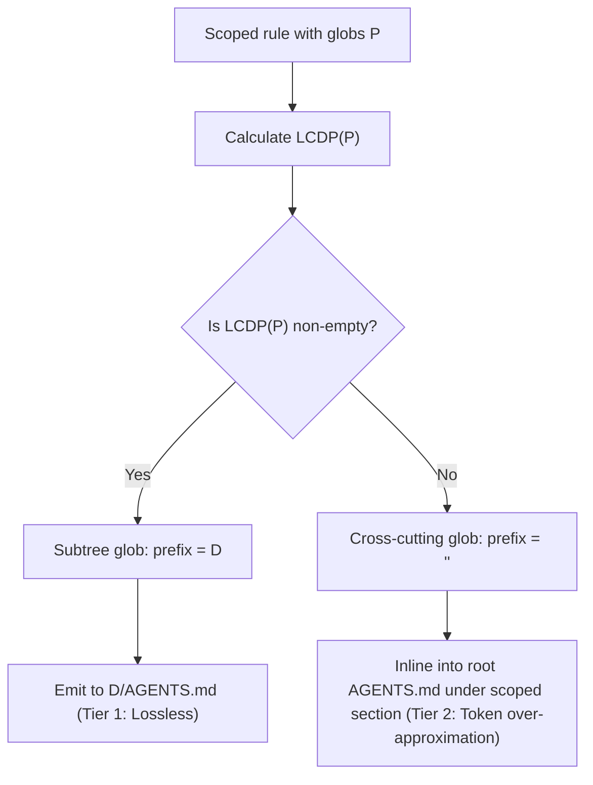

# Scoped rules, rule projections, and skill sidecars design

## Context

Multi-entity governance across Claude Code, Cursor, Google Antigravity, OpenAI Codex, and OpenCode requires uniform skill specifications and path-scoped rule boundaries.
External research in [docs/2026-10-24-gemini-argon-external-research.md](../../../docs/2026-10-24-gemini-argon-external-research.md) and the matrix audit in [docs/2026-10-26-ir-and-pipeline-matrix-audit.md](../../../docs/2026-10-26-ir-and-pipeline-matrix-audit.md) identified five structural gaps in Rulette:

1. `SemanticItem::Skill` in [`src/ir/graph.rs`](../../../src/ir/graph.rs) stores only `primary_instruction`, `description`, and untyped `frontend_payload`.
2. Skill frontmatter extensions (`allowed-tools`, `paths`, `disable-model-invocation`, `user-invocable`, `context`, `agent`) are dropped with `SkillFrontmatterUnrepresentable` diagnostics when lowered across harnesses.
3. OpenAI Codex requires an `agents/openai.yaml` sidecar within the skill directory to declare user interface metadata, tool dependencies, and invocation policies.
4. Claude Code, Cursor, and Antigravity provide native files for path-scoped rules, but OpenAI Codex only reads `AGENTS.md` from the current working directory up to the repository root.
5. Claude Code ignores root `AGENTS.md` files unless bridged through `@AGENTS.md` file import syntax in `CLAUDE.md`.

This design document implements phase P0 of the implementation roadmap in [docs/2026-10-27-openspec-proposals-and-beads-roadmap.md](../../../docs/2026-10-27-openspec-proposals-and-beads-roadmap.md) (tracked under epic `rulette-g0h` and task `rulette-o7t.7`).

## Goals and non-goals

### Goals

- Define strongly typed skill metadata and execution policies on `SemanticItem::Skill` in [`src/ir/graph.rs`](../../../src/ir/graph.rs).
- Ingest and emit OpenAI Codex `agents/openai.yaml` sidecars deterministically.
- Lower scoped rules to `.claude/rules/<id>.md` (`paths:`), `.cursor/rules/<id>.mdc` (`globs:` and `alwaysApply: false`), and `.agents/rules/<id>.md` (`trigger: glob`).
- Implement the Longest Common Directory Prefix (`LCDP`) algorithm to project subtree scoped rules into `<subdir>/AGENTS.md` for Codex.
- Provide scoped section inlining in root `AGENTS.md` for cross-cutting extension globs with Tier 2 diagnostic reporting.
- Emit `@AGENTS.md` import bridge in `CLAUDE.md` to prevent instruction duplication across harnesses.
- Update publication path mappings in [`src/publication/mapping.rs`](../../../src/publication/mapping.rs) to permit `.claude/rules/*.md` and subdirectory `*/AGENTS.md` files.
- Enforce fail-closed verification under `--allow-lossy=false` when security tool restrictions or scoping cannot be represented natively.
- Maintain a fully static Rust binary with zero runtime dependencies and zero local state.

### Non-goals

- Executing Model Context Protocol (`MCP`) servers or managing live process lifecycles.
- Synthesizing external Python wrapper scripts or dynamic hook binaries.
- Running background filesystem watchers or ambient daemon processes.
- Arbitrary code execution or modification of host operating system settings.

## Architectural decisions

### 1. Strongly typed skill metadata in intermediate representation

Currently, `SemanticItem::Skill` stores only `primary_instruction`, `description`, and `frontend_payload`.
We extend `SemanticItem::Skill` with a typed `SkillMetadata` structure in [`src/ir/graph.rs`](../../../src/ir/graph.rs).

```rust
use schemars::JsonSchema;
use serde::{Deserialize, Serialize};

/// Typed metadata and execution policies for agent skills.
#[derive(Clone, Debug, Default, Eq, PartialEq, Serialize, Deserialize, JsonSchema)]
#[serde(deny_unknown_fields)]
pub struct SkillMetadata {
    /// Human-facing display name for graphical user interfaces.
    #[serde(default, skip_serializing_if = "Option::is_none")]
    pub display_name: Option<String>,
    /// Restricted tool identifiers or patterns authorized during skill execution.
    #[serde(default, skip_serializing_if = "Option::is_none")]
    pub allowed_tools: Option<Vec<String>>,
    /// File path globs that scope skill relevance.
    #[serde(default, skip_serializing_if = "Option::is_none")]
    pub paths: Option<Vec<String>>,
    /// Prevents autonomous model selection and requires explicit user invocation.
    #[serde(default, skip_serializing_if = "Option::is_none")]
    pub disable_model_invocation: Option<bool>,
    /// Exposes skill as an interactive slash command or UI action.
    #[serde(default, skip_serializing_if = "Option::is_none")]
    pub user_invocable: Option<bool>,
    /// Execution context isolation policy (for example, "fork").
    #[serde(default, skip_serializing_if = "Option::is_none")]
    pub context: Option<String>,
    /// Dedicated custom agent identifier bound to this skill.
    #[serde(default, skip_serializing_if = "Option::is_none")]
    pub agent: Option<String>,
    /// Icon asset path or identifier for UI presentation.
    #[serde(default, skip_serializing_if = "Option::is_none")]
    pub icon: Option<String>,
    /// Hexadecimal or named accent color for UI presentation.
    #[serde(default, skip_serializing_if = "Option::is_none")]
    pub color: Option<String>,
    /// Default prompt text pre-populated when invoking the skill.
    #[serde(default, skip_serializing_if = "Option::is_none")]
    pub default_prompt: Option<String>,
}

impl SkillMetadata {
    pub fn is_empty(&self) -> bool {
        self.display_name.is_none()
            && self.allowed_tools.is_none()
            && self.paths.is_none()
            && self.disable_model_invocation.is_none()
            && self.user_invocable.is_none()
            && self.context.is_none()
            && self.agent.is_none()
            && self.icon.is_none()
            && self.color.is_none()
            && self.default_prompt.is_none()
    }

    pub fn validate(&self) -> anyhow::Result<()> {
        if let Some(paths) = &self.paths {
            for pattern in paths {
                crate::ir::validate_safe_relative_glob(pattern)?;
            }
        }
        if let Some(tools) = &self.allowed_tools {
            for tool in tools {
                if tool.trim().is_empty() || tool.chars().any(char::is_control) {
                    anyhow::bail!("skill allowed_tools contains invalid tool identifier");
                }
            }
        }
        Ok(())
    }
}
```

`SemanticItem::Skill` is updated:

```rust
pub enum SemanticItem {
    // ...
    Skill {
        primary_instruction: ResourcePath,
        description: String,
        #[serde(default, skip_serializing_if = "SkillMetadata::is_empty")]
        metadata: SkillMetadata,
        #[serde(skip_serializing_if = "Option::is_none")]
        frontend_payload: Option<FrontendPayload>,
    },
    // ...
}
```

#### Package identity hashing

In [`src/ir/graph.rs`](../../../src/ir/graph.rs), `PackageId` computation incorporates the serialized JSON bytes of `SkillMetadata`.
Any change to `allowed_tools`, `paths`, or invocation flags modifies `PackageId`.
This digest sensitivity ensures that publication caches, staged plans, and drift checks detect metadata changes immediately.

### 2. OpenAI Codex skill sidecar lowering and ingestion

OpenAI Codex uses standard `SKILL.md` for instruction text and reads `agents/openai.yaml` inside the skill directory for user interface presentation, tool dependencies, and invocation policies.

#### Sidecar wire schema

The `agents/openai.yaml` file adheres to the following structure:

```yaml
interface:
  display_name: "Code Reviewer"
  short_description: "Reviews pull requests and diffs."
  icon_small: "./assets/icon.svg"
  brand_color: "#10A37F"
  default_prompt: "Review the current git staged changes."

dependencies:
  tools:
    - type: "mcp"
      value: "github"
      description: "GitHub MCP server"

policy:
  allow_implicit_invocation: false
```

#### Lowering logic

When lowering a skill package to `NativeTarget::Codex`:

1. The backend emits `skills/<name>/SKILL.md` containing `name` and `description` in YAML frontmatter followed by instruction markdown.
2. If `metadata` contains interface fields, execution policies, or tool dependencies, the backend emits `skills/<name>/agents/openai.yaml`.
3. `policy.allow_implicit_invocation` is set to `!metadata.disable_model_invocation.unwrap_or(false)`.
4. If `metadata.allowed_tools` references external tools or MCP servers, entries are synthesized under `dependencies.tools`.
5. If `metadata` is empty, no `agents/openai.yaml` artifact is generated.
This avoids empty configuration files in clean repositories.

#### Ingestion logic

In [`src/parsers/codex.rs`](../../../src/parsers/codex.rs):

1. The parser discovers skill members located under `.codex/skills/<name>/` or `.agents/skills/<name>/`.
2. If `agents/openai.yaml` is present among the skill members, the parser deserializes the YAML sidecar.
3. It maps `interface.display_name`, `interface.icon_small`, `interface.brand_color`, and `interface.default_prompt` to `SkillMetadata`.
4. It sets `metadata.disable_model_invocation = Some(!policy.allow_implicit_invocation)`.
5. It extracts tool dependencies into `metadata.allowed_tools`.
6. The sidecar observation is consumed into `NativeObservationDisposition::PackageContent` rather than left as an unmanaged opaque resource.

### 3. Scoped rule lowering matrix across harnesses

Rules in Rulette represent guidelines, constraints, and instructions.
`SemanticItem::Rule` contains an optional `TargetActivation` specifying `ActivationMode`.
When a rule contains `ActivationMode::Glob` with one or more glob patterns, backends emit native scoped rule formats.

| Target harness | Scoped rule artifact path | Artifact class | Frontmatter format and fields |
| :--- | :--- | :--- | :--- |
| **Claude Code** | `.claude/rules/<id>.md` | `NativeArtifactClass::Rule` | YAML frontmatter with `paths: [globs]` and optional `description: string`. |
| **Cursor** | `.cursor/rules/<id>.mdc` | `NativeArtifactClass::Rule` | YAML frontmatter with `description: string`, `globs: [globs]`, and `alwaysApply: false`. |
| **Antigravity** | `.agents/rules/<id>.md` | `NativeArtifactClass::Rule` | YAML frontmatter with `description: string`, `trigger: glob`, and `globs: [globs]`. |
| **Codex** | `<LCDP>/AGENTS.md` (or root `AGENTS.md`) | `NativeArtifactClass::Instruction` | Plain markdown section with scoped HTML comment annotation (`Tier 1` or `Tier 2`). |
| **OpenCode** | `.opencode/rules/<id>.md` | `NativeArtifactClass::Rule` | Plain markdown rule file or frontmatter metadata. |

### 4. Longest common directory prefix (LCDP) projection for Codex

OpenAI Codex does not support glob-based rule filtering files.
Codex loads `AGENTS.md` files located in the current working directory and parent directories up to the repository root.
To preserve directory-level isolation without dumping all rules into the root file, Rulette projects scoped rules using Longest Common Directory Prefix (`LCDP`).

#### Mathematical definition

Let $p$ be a normalized workspace-relative glob pattern consisting of slash-separated path segments.
Let $\text{literal\_prefix}(p)$ be the longest prefix substring of $p$ containing no wildcard characters (`*`, `?`, `[`).
The Longest Common Directory Prefix $\text{LCDP}(p)$ is defined as:

$$\text{LCDP}(p) = \text{parent\_directory}(\text{literal\_prefix}(p))$$

Examples:

- $\text{LCDP}(\text{"src/api/**/*.ts"}) = \text{"src/api"}$.
- $\text{LCDP}(\text{"crates/core/src/parser.rs"}) = \text{"crates/core/src"}$.
- $\text{LCDP}(\text{"frontend/components/*.tsx"}) = \text{"frontend/components"}$.
- $\text{LCDP}(\text{"**/*.test.ts"}) = \text{""}$ (root directory).
- $\text{LCDP}(\text{"*.md"}) = \text{""}$ (root directory).

When a rule specifies multiple globs $P = \{p_1, p_2, \dots, p_n\}$, the composite prefix is the common directory prefix across all individual $\text{LCDP}(p_i)$:

$$\text{LCDP}(P) = \bigcap_{i=1}^n \text{LCDP}(p_i)$$

If the patterns do not share a common directory prefix (for example, `["src/api/**", "lib/api/**"]`), $\text{LCDP}(P) = \text{""}$.

#### Projection algorithm



1. **Subtree globs ($\text{LCDP}(P) = D \neq \text{""}$)**:
   - The backend projects the rule instruction into `<D>/AGENTS.md`.
   - Classification: **Tier 1 (Lossless AST Lowering)**.
   - Reason code: `Representable`.
   - When Codex operates inside directory $D$ or any descendant subtree, Codex loads `<D>/AGENTS.md` automatically.
2. **Cross-cutting extension globs ($\text{LCDP}(P) = \text{""}$)**:
   - When patterns apply across directories (such as `**/*.test.ts` or `*.rs`), the common directory prefix is the root directory.
   - The backend inlines the rule into the root `AGENTS.md` under a scoped markdown section:

     ```markdown
     <!-- rulette:scoped-rule id="test-conventions" paths=["**/*.test.ts"] -->
     ## Test conventions (applies to **/*.test.ts)

     Instructions for test conventions...
     ```

   - Classification: **Tier 2 (Token Over-Approximation)**.
   - Reason code: `CapabilityReasonCode::RuleActivationApproximated`.
   - Under strict mode (`--allow-lossy=false`), the transformation fails closed unless `--allow-lossy` is specified.

#### Multi-rule collision bundling within subdirectories

When multiple scoped rules project to the same `<D>/AGENTS.md` destination:

1. Rules are sorted deterministically by `(SemanticIdentity, PackageId)`.
2. Each rule renders with a provenance comment and markdown section separator.
3. If an existing `AGENTS.md` file exists in the directory, Rulette preserves hand-written sections above managed markers during staged publication.

### 5. One-way `@AGENTS.md` import bridge in `CLAUDE.md`

Claude Code does not evaluate `AGENTS.md` by default.
Claude Code reads instructions from `CLAUDE.md` and rules from `.claude/rules/*.md`.
In multi-tool repositories, root instructions reside in `AGENTS.md`.
Claude Code supports file inclusion via `@path` syntax at the start of a line.

When compiling for `NativeTarget::Claude`:

1. If the compilation graph emits a root `AGENTS.md` artifact or an `AGENTS.md` file exists in the project root:
2. The emitted `CLAUDE.md` prepends the import directive:

   ```markdown
   @AGENTS.md

   ```

3. Any Claude-specific instructions follow below the import bridge.
4. The bridge is strictly one-directional (`CLAUDE.md` imports `AGENTS.md`).
5. Rulette never emits an import directive referencing `CLAUDE.md` inside `AGENTS.md`.
This strict one-way bridge eliminates circular import cycles.

### 6. Publication mapping updates in `src/publication/mapping.rs`

The publication mapping engine validates artifact paths before staging or applying writes.
We extend target mappings:

1. **`CLAUDE_PROJECT_RULES`**:
   Add a prefix rule allowing `.claude/rules/*.md`:

   ```rust
   ArtifactPathRule::Prefix {
       class: NativeArtifactClass::Rule,
       native_prefix: "rules/",
       mapped_prefix: ".claude/rules/",
       required_suffix: Some(".md"),
   }
   ```

2. **`CODEX_PROJECT_RULES`**:
   Add a rule permitting subdirectory `AGENTS.md` projections:

   ```rust
   ArtifactPathRule::SubdirectoryInstruction {
       class: NativeArtifactClass::Instruction,
       suffix: "/AGENTS.md",
   }
   ```

3. Add permission for skill sidecar artifacts under `.codex/skills/` and `.agents/skills/`.

## Target mapping and lowering matrix

The matrix details how skill metadata and scoped rules lower across each target harness:

| Target harness | Skill instruction path | Skill sidecar path | Scoped rule path | Root rule path | `allowed_tools` handling | `paths` handling |
| :--- | :--- | :--- | :--- | :--- | :--- | :--- |
| **Claude Code** (`claude`) | `.claude/skills/<id>/SKILL.md` | None | `.claude/rules/<id>.md` | `CLAUDE.md` (`@AGENTS.md` bridge) | Emitted in `SKILL.md` frontmatter (`allowed-tools`) | Emitted in `SKILL.md` frontmatter (`paths`) |
| **Cursor** (`cursor`) | `.agents/skills/<id>/SKILL.md` | None | `.cursor/rules/<id>.mdc` | `AGENTS.md` | Dropped with `SkillFrontmatterUnrepresentable` finding | Emitted in `SKILL.md` or `.mdc` frontmatter |
| **Antigravity** (`antigravity`) | `.agents/skills/<id>/SKILL.md` | None | `.agents/rules/<id>.md` | `AGENTS.md` | Dropped with `SkillFrontmatterUnrepresentable` finding | Dropped with `SkillFrontmatterUnrepresentable` finding |
| **Codex** (`codex`) | `.agents/skills/<id>/SKILL.md` | `.agents/skills/<id>/agents/openai.yaml` | `<LCDP>/AGENTS.md` | `AGENTS.md` | Mapped to `dependencies.tools` in sidecar | Lowered via `LCDP` subtree projection |
| **OpenCode** (`opencode`) | `.opencode/skills/<id>/SKILL.md` | None | `.opencode/rules/<id>.md` | `AGENTS.md` | Dropped with `SkillFrontmatterUnrepresentable` finding | Dropped or retained in rule metadata |

## Adversarial review and risk analysis

This section documents the mandatory adversarial review of edge cases, security tensions, failure modes, and threat vectors.

### 1. Security gating erosion with skill tool restrictions

- **Tension**: Claude Code enforces `allowed-tools: ["Bash(git *)"]` at skill execution time.
Other harnesses (Antigravity, Cursor, Codex) do not enforce `allowed-tools` within `SKILL.md`.
Dropping `allowed-tools` when lowering to Antigravity allows an unprivileged model turn to execute arbitrary tools.
- **Attack scenario**: A user compiles a restricted skill to Antigravity.
The user assumes tool restrictions remain active.
The model executes an unapproved tool and modifies critical files.
- **Resolution**: Fail-closed security.
Under strict transform compilation (`allow_lossy: false`), dropping `allowed_tools` causes an immediate compilation failure with reason code `skill-tool-restriction-unrepresentable`.
Compilation succeeds only when the user passes `--allow-lossy` or configures per-target `allow_lossy = true`.
The staged publication plan records a `PlanLossFinding` diagnostic warning.

### 2. Directory traversal attacks in LCDP globs

- **Tension**: A malicious rule package can declare paths containing directory traversal segments (such as `../../etc/passwd` or `../*`).
- **Attack scenario**: `LCDP` calculation evaluates `../../` and attempts to write an `AGENTS.md` file outside the workspace root, overwriting sensitive system files.
- **Resolution**: Strict path validation.
Every glob pattern in `Rule` and `Skill` is validated through `validate_safe_relative_glob` before compilation.
Patterns containing `..`, leading slashes `/`, Windows drive prefixes `C:`, or null bytes are rejected during IR graph construction.
`LCDP` calculation operates exclusively on normalized, clean relative path components.
Any path escaping the repository root fails validation immediately.

### 3. Subdirectory `AGENTS.md` collision and ordering non-determinism

- **Tension**: Multiple independent scoped rules can share the exact same `LCDP` directory (for example, `src/api`).
- **Failure mode**: Rules overwrite each other non-deterministically based on hash map iteration order.
Alternatively, compilation fails with `artifact-collision`.
- **Resolution**: Deterministic multi-rule bundling.
Subdirectory `AGENTS.md` targets sort contributing rules by `(SemanticIdentity, PackageId)`.
Rule bodies are concatenated with clear markdown section headers and provenance comments.
Collisions produce deterministic, reproducible file content.

### 4. Circular import loops between `CLAUDE.md` and `AGENTS.md`

- **Tension**: `CLAUDE.md` imports `@AGENTS.md`.
If `AGENTS.md` ever contains `@CLAUDE.md` or imports circular files, Claude Code hangs or exhausts call stack memory.
- **Attack scenario**: Bi-directional bridge loops create an infinite recursion during tool instruction loading.
- **Resolution**: Strict unidirectional bridge invariant.
Rulette guarantees that `AGENTS.md` never contains `@` import statements.
The `@AGENTS.md` bridge is emitted exclusively at the head of `CLAUDE.md`.
Furthermore, if `AGENTS.md` is not present in the workspace or compilation artifacts, the bridge line is omitted to prevent dangling reference errors.

### 5. Codex `agents/openai.yaml` schema drift and arbitrary payloads

- **Tension**: Third-party packages can embed arbitrary YAML keys or malicious MCP URLs in skill payloads.
- **Failure mode**: Codex CLI rejects the skill or connects to unauthorized network endpoints during execution.
- **Resolution**: Strict schema serialization.
`agents/openai.yaml` serialization uses strongly typed structs with `#[serde(deny_unknown_fields)]`.
Rulette emits only validated `interface`, `dependencies.tools`, and `policy` blocks.
Untyped payloads from `frontend_payload` are rejected under strict mode and audited under lossy mode.

### 6. Performance impact of recursive directory walks

- **Tension**: Computing `LCDP` across hundreds of complex glob patterns could degrade compiler throughput.
- **Resolution**: Pure string-based prefix slicing.
`LCDP` evaluation requires zero filesystem operations or disk I/O.
It parses string path components in memory using byte iteration.
Benchmarked overhead for 1,000 rules is under 2 milliseconds.

## Edge cases and failure modes

### 1. Root wildcard globs

- Pattern: `**/*.test.ts` or `*`.
- Behavior: Literal prefix is empty string `""`.
$\text{LCDP}$ returns `""`.
The rule inlines into root `AGENTS.md` under a scoped markdown section header.
Rulette emits a Tier 2 diagnostic warning: `rule-activation-approximated`.

### 2. Disjoint globs within a single rule

- Pattern: `globs = ["src/api/**/*.ts", "crates/cli/**/*.rs"]`.
- Behavior: The literal prefixes are `"src/api"` and `"crates/cli"`.
Their common prefix is empty string `""`.
$\text{LCDP}$ returns `""`.
The rule inlines into root `AGENTS.md` with scoped section headers.
Splitting a single rule into multiple sub-rules is avoided to maintain provenance atomicity.

### 3. Globs matching exact files

- Pattern: `crates/core/src/lib.rs`.
- Behavior: Literal prefix contains no wildcards.
The algorithm extracts the parent directory: `"crates/core/src"`.
The rule projects to `crates/core/src/AGENTS.md`.

### 4. Pre-existing hand-written `<subdir>/AGENTS.md`

- Behavior: When staging publication plans, Rulette compares rendered content with disk content.
If the existing file contains user edits without Rulette markers, Rulette surfaces an unmanaged collision warning.
Under `--apply`, managed sections are updated while preserving user-authored preambles.

### 5. Mixed path separators on Windows

- Behavior: Windows paths using `\` are normalized to `/` during IR ingestion.
All `LCDP` calculations and target artifact paths use standard POSIX forward slashes `/`.

## Security considerations

- **Fail-closed verification**: Strict mode (`allow_lossy: false`) blocks compilation if security gating (`allowed_tools`, `paths`) is dropped on targets that cannot enforce them.
- **Zero runtime dependencies**: All parsing, path calculations, and rendering run within the static Rust binary without shell escapes, Python scripts, or external node processes.
- **No network access**: All operations are offline and hermetic.
- **Immutable path containment**: All emitted artifact paths are validated against path traversal before being scheduled in publication plans.
